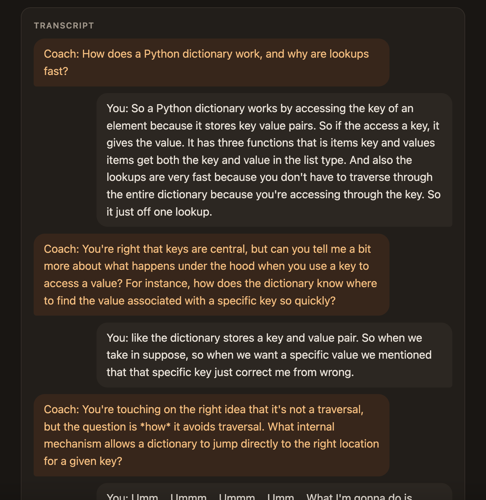
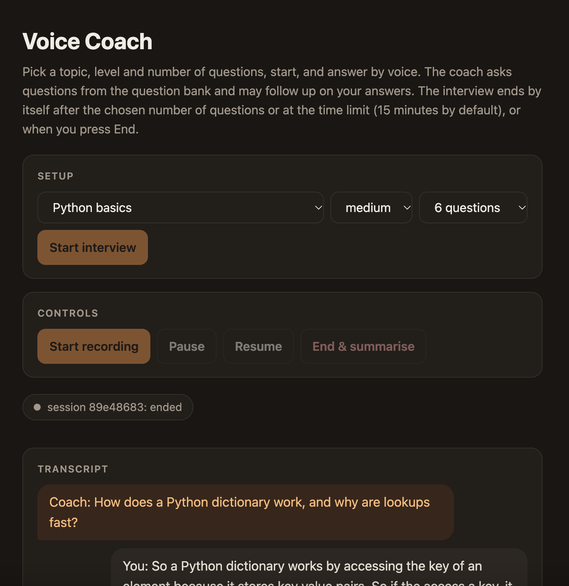
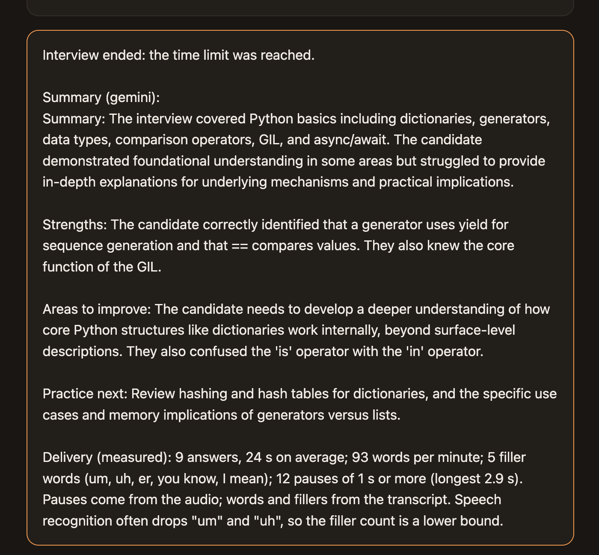
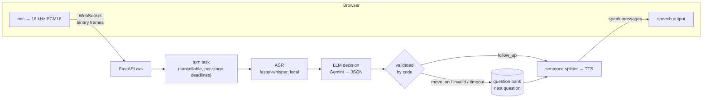
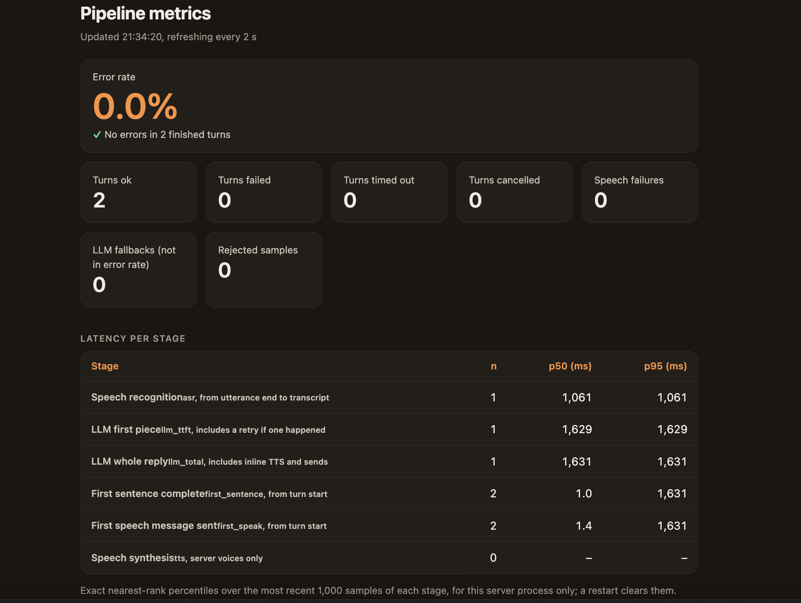

# Voice Coach: a spoken mock-interview coach

[](https://github.com/nik1taa28/voice-coach/actions/workflows/ci.yml)


A voice-first interview practice tool. The coach **asks a technical question out loud**, you **answer by microphone**, your speech is **transcribed locally with Whisper**, an **LLM (Gemini) decides whether to probe deeper or move on**, and the reply is **spoken back**. At the end you get a written summary and **measured delivery feedback** (words per minute, filler words, pauses).

Built with async Python, FastAPI and WebSockets, with a focus on what makes real-time systems hard: cancellation, timeouts, fallbacks, latency measurement and load testing. Free tools only; runs with **no API keys** in demo mode.



| Setup and controls | End summary with measured delivery feedback |
|---|---|
|  |  |

## Highlights

- **Real-time audio over WebSockets.** The browser captures the mic with an AudioWorklet, downsamples to 16 kHz PCM16 and streams binary frames to FastAPI. faster-whisper runs in a worker thread (`asyncio.to_thread`), so one slow transcription doesn't block other sessions.
- **The code runs the interview, not the LLM.** Questions come from a curated, validated bank (98 questions, 8 topics, 3 levels). After each answer the LLM only returns a JSON decision, `follow_up` or `move_on`. The code validates it, caps follow-ups, and falls back cleanly on invalid output, timeouts or errors.
- **Reliability by design.** Each turn is a cancellable `asyncio` task. Pause, End or closing the tab cancels in-flight ASR, LLM and TTS work and closes the upstream HTTP stream. Every stage has a deadline. The LLM is retried once, and only before any output (so the user never hears a reply twice).
- **Pluggable providers with deterministic fakes.** ASR, LLM and TTS each sit behind a small `typing.Protocol`. Fakes power demo mode and let tests inject hung, slow and flaky providers.
- **Observability.** JSON logs carry the session id through a `contextvar`. `/metrics` reports p50/p95 per stage plus an error rate, `/dashboard` shows them live, and a Locust load test produced the baseline report.
- **Delivery feedback from signals, not ML.** Pauses come from audio energy, and words per minute and fillers from the transcript. The numbers are computed by code, never guessed by the LLM.
- **Shipped properly.** 308 pytest tests, a Docker image (non-root, healthcheck, 251 MB) and GitHub Actions CI that tests and smoke-runs the container.

## How it works



A session is a state machine (`idle → listening ⇄ thinking → ending → ended`, plus `paused`). Every event is checked in one place, and history is written only when a reply completes, so a cancelled turn rolls back cleanly. The interview ends by itself after the chosen number of questions, at a time limit (15 min by default), or when you press End.

Full protocol, state diagram and per-part status: [docs/architecture.md](docs/architecture.md).

## Measured performance

Real measurements on one Apple M3 laptop (8 cores, 16 GB). The load generator ran on the same machine, so treat these as relative behaviour, not server capacity. Method, raw data and caveats: [docs/performance.md](docs/performance.md).



| Scenario | Result |
|---|---|
| A real interview in Chrome (Whisper `tiny.en`, Gemini 2.5 Flash, browser voice) | A **25 s spoken answer transcribed in 614 ms**; Gemini first token 2848 ms; stop press → first sound 3636 ms *(single session)* |
| Load test, fake providers, 1 → 100 concurrent users (3 repeats each) | **0 failures**, throughput scaled about linearly to ~337 req/s, server-side p50 under 5 ms at 100 users |
| Load test, real Whisper, 1 → 32 users | 0 failures. Throughput plateaus at **about 4 answers/s**; beyond 8 users, ASR p50 grows from 674 ms to 7.2 s (queueing in the ASR stage, found from per-stage metrics) |
| Whisper cold start | first transcription 788–898 ms including model load (6 fresh servers) |

## Quick start (demo mode, no keys)

```bash
python3 -m venv .venv
.venv/bin/pip install -r requirements.txt
.venv/bin/python -m uvicorn backend.main:app
```

Open http://127.0.0.1:8000, pick a topic and level, press **Start interview**, then **Start recording**. In demo mode every fake stage is labelled on the page ("FAKE coach", "FAKE voice: a beep"); a fake never passes as real.

### Real providers (all free)

| Stage | Setting | Options | Notes |
|---|---|---|---|
| Speech recognition | `ASR_PROVIDER` | `fake` (default), `whisper` | Local faster-whisper (`tiny.en`, int8, CPU); `pip install -r requirements-asr.txt`. Audio never leaves the machine |
| Coach (LLM) | `LLM_PROVIDER` | `fake` (default), `gemini` | Gemini free tier over HTTPS + server-sent events. Needs `GEMINI_API_KEY` |
| Voice | `TTS_PROVIDER` | `fake` (default, a beep), `browser` | The browser's `speechSynthesis` |

```bash
ASR_PROVIDER=whisper LLM_PROVIDER=gemini TTS_PROVIDER=browser GEMINI_API_KEY=... \
  .venv/bin/python -m uvicorn backend.main:app
```

`.env` is not loaded automatically; export the variables in your shell (see `.env.example`). Never commit a key.

### Docker

```bash
docker build -t voice-coach .
docker run --rm -p 127.0.0.1:8000:8000 voice-coach      # demo mode
```

Pass real-provider settings with `-e`. `--build-arg WITH_ASR=1` adds local Whisper (a larger image). The port is published on `127.0.0.1` only because `/metrics` has no authentication.

## Tests and CI

```bash
.venv/bin/python -m pytest -q        # 308 passed in ~6 s
```

Unit tests cover the state machine, the decision validator, the question bank, the sentence splitter, metrics and delivery analysis. WebSocket tests use fakes that **hang, run slow or fail** to check Pause and End mid-reply, LLM timeouts and retries, invalid LLM output, TTS failure and client disconnect. CI runs the suite on every push, then builds the Docker image, starts it and checks `/health`, `/`, `/metrics` and `/dashboard`.

## Observability

- `GET /metrics`: JSON with p50/p95 per stage (`asr`, `llm_ttft`, `llm_total`, `first_sentence`, `first_speak`, `tts`), outcome counters, `error_rate` and an LLM fallback count.
- `GET /dashboard`: a live page polling `/metrics` every 2 s.
- Structured JSON logs, one line per event, each tagged with the `session_id`.
- Load test: `pip install -r requirements-dev.txt`, then `bash loadtest/sweep.sh 1 10 50 100`.

## Design decisions

| Decision | Why | Trade-off |
|---|---|---|
| Questions from a curated bank; the LLM only decides follow-up vs move-on | Predictable, on-topic interviews; the model can't invent or repeat questions | The bank needs to be written and maintained by hand |
| The LLM returns validated JSON instead of free text | The code enforces the follow-up cap and catches bad output | Follow-ups wait for the full reply instead of streaming (measured cost: ~14 ms median over 3 real calls) |
| Retry the LLM only before any output | A retry after output would make the user hear text twice | A permanent error (bad key) still costs one retry |
| Whisper in `asyncio.to_thread` | Keeps the event loop free while the CPU decodes | A timed-out thread can't be killed; it finishes in the background |
| Monotonic clocks per stage; browser and server clocks never mixed | Accurate, comparable latency numbers | The browser's voice timing is measured only on the client |

More decisions with alternatives: [docs/learning-notes.md](docs/learning-notes.md).

## Known limitations

- **Push-to-talk.** There's no voice activity detection or barge-in, and ASR waits for the whole answer. In the one real session, stop → first sound was about 3.6 s.
- **Single process, in-memory sessions**, with no admission limit. Past about 4 answers/s, users wait longer instead of being told the server is busy.
- **`tiny.en` mishears some technical words** (e.g. "GIL" → "Gail"). Larger Whisper models are supported but their latency hasn't been measured yet.
- **No persistence.** Session history isn't saved between interviews.
- Tested in Chrome; Safari and Firefox are untested. Timeouts are starting values, not yet tuned from data. The question bank is self-written and self-reviewed.

Per-part status (Planned / Implemented / Verified): [docs/architecture.md](docs/architecture.md).

## Project layout

```
backend/
  main.py            FastAPI app: /health, /ws, turn task, SafeSender
  session_state.py   interview state machine (pure)
  decision.py        validates the LLM's JSON decision
  reliability.py     deadlines, retry rule, TurnRunner
  questions.py       question bank: load, validate, pick
  delivery.py        words per minute, fillers, pauses (pure, no numpy)
  metrics.py         p50/p95 per stage, outcome counters
  logs.py            JSON logs with the session id (contextvar)
  sentences.py       streaming sentence splitter
  prompts.py         follow-up and summary prompts
  asr/ llm/ tts/     provider interface + fake + real implementation
data/question_bank.json   98 questions: topic, difficulty, question, key points
frontend/            index.html (app) and dashboard.html, plain HTML + vanilla JS
loadtest/            Locust file, sweep scripts, raw results
tests/               pytest, with slow / failing fakes
docs/                architecture, performance, learning notes
```

## What's next

- Voice activity detection and barge-in (interrupt the coach mid-sentence)
- Saved session history to track progress across interviews
- A hosted demo-mode instance
- An evaluation set: Whisper word error rate on technical terms, and the share of valid LLM decisions over many calls
