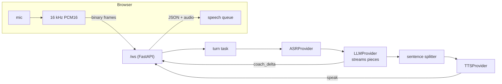

# Voice Coach: a spoken mock-interview coach

The coach asks an interview question out loud. You answer into your microphone. The app transcribes it, an LLM writes a short follow-up, and the app speaks it. Controls: start / pause / end, topic and difficulty, a live transcript, and a short end summary.

Built as a portfolio project to practise async Python, WebSockets, provider interfaces, reliability and testing. It is deliberately small: a plain prompt plus conversation history, no RAG, no agent framework, no paid services.

> **Demo mode needs no keys.** The default ASR, LLM and TTS are deterministic fakes. The page labels each fake stage ("FAKE speech recognition", "FAKE coach", "FAKE voice: a beep"). A fake never passes as real.

## Quick start (demo mode)

```bash
python3 -m venv .venv
.venv/bin/pip install -r requirements.txt
.venv/bin/python -m uvicorn backend.main:app
```

Open http://127.0.0.1:8000, choose a topic and difficulty, press Start, then record an answer with the microphone button. With fakes the "transcript" only reflects the audio length, and the coach's questions are canned.

## Real providers (all free)

Nothing loads `.env` automatically yet. Export the variables in your shell. See `.env.example`.

| Stage | Setting | Options | Notes |
|---|---|---|---|
| ASR | `ASR_PROVIDER` | `fake` (default), `whisper` | `whisper` = local faster-whisper (`tiny.en`, int8, CPU). `pip install -r requirements-asr.txt`. Audio stays on the machine; the first call downloads the model |
| LLM | `LLM_PROVIDER` | `fake` (default), `gemini` | Gemini free tier over plain HTTPS + server-sent events. Needs `GEMINI_API_KEY`. Transcripts leave the machine. Never hard-code the key |
| TTS | `TTS_PROVIDER` | `fake` (default, a beep), `browser` | `browser` uses the browser's `speechSynthesis`; the server cannot time it. Voices differ per browser and OS |

Example: `ASR_PROVIDER=whisper LLM_PROVIDER=gemini TTS_PROVIDER=browser GEMINI_API_KEY=... .venv/bin/python -m uvicorn backend.main:app`

## How it works



- **Providers behind small interfaces** (`typing.Protocol`), each with a deterministic fake used by demo mode and tests.
- **Honest streaming:** audio is streamed in, but ASR waits for the whole utterance. The LLM reply streams in pieces, and each *complete sentence* goes to TTS while the model writes the next one. It is not token-level TTS.
- **State machine** (`session_state.py`): idle, listening, thinking, paused, ended. Every event is checked in one place; history is written only when a reply is complete.
- **Reliability (M4):** each answer runs as a cancellable task so the server keeps reading Pause / End / disconnect. Per-stage deadlines; the LLM is retried once, only before its first piece (a later retry would repeat text the user already saw); a closed tab cancels the work and closes the upstream stream.
- **Timing:** server stages use `time.perf_counter()`. The browser measures stop-press to first sound on its own clock; the two clocks are never mixed.

Full detail, protocol and per-part status (Planned / Implemented / Verified): [docs/architecture.md](docs/architecture.md). Design decisions and what I learned: [docs/learning-notes.md](docs/learning-notes.md).

## Tests

```bash
.venv/bin/python -m pytest -q
```

148 tests pass at the time of writing (unit tests, plus WebSocket tests using slow and failing fakes: hung or flaky LLM, hung ASR/TTS, Pause/End mid-reply, disconnect). Note that `tests/test_whisper.py` needs numpy, which comes with `requirements-asr.txt`. The suite has no per-test timeout; if one hangs, run it with `-o faulthandler_timeout=15` to see where.

## Measured so far (honest numbers)

These are **single samples on one laptop, not distributions**. Hardware was not recorded. A proper p50/p95 baseline is planned for M5.

| What | Sample |
|---|---|
| Whisper `tiny.en`, warm call | 987.6 ms for 7.3 s of audio (rtf 0.135) |
| Whisper, first ever call (model download + load included) | 20951 ms |
| Gemini `gemini-2.5-flash`, opener, TTFT / total | 3129 ms / 3283 ms |
| Stop press to first sound, fake ASR + fake LLM (overhead floor only) | 52 ms (fake voice), 69 ms (browser voice) |

The real pipeline (Whisper + Gemini + voice end to end) has **not** been measured yet.

## Known limitations

- The deadlines (ASR 30 s, LLM first piece 10 s, LLM total 30 s, TTS 5 s per sentence) are starting guesses, overridable with `TIMEOUT_*` variables. They are not tuned from data.
- A timed-out Whisper call cannot be killed: its worker thread keeps using CPU until it finishes.
- TTS runs inline in the LLM stream loop, so a slow server-side TTS delays reading the LLM.
- No fallback providers (for example a second LLM). The only fallbacks are the LLM retry and a text-only reply when TTS fails.
- Tested in VS Code's built-in browser only (probably Chromium, not confirmed). Real Chrome, Safari and Firefox are untested. `speechSynthesis` behaves differently across them.
- The spoken summary is text only. The tail of the audio (under about 43 ms) is dropped when recording stops.
- Not yet verified with real Gemini or Whisper through the M4 task path.

## Project layout

```
backend/
  main.py            FastAPI app, /health, /ws, turn task, SafeSender
  session_state.py   interview state machine (pure)
  reliability.py     deadlines, retry rule, TurnRunner (pure asyncio)
  sessions.py        message builders, utterance buffer
  sentences.py       streaming sentence splitter
  prompts.py         prompt + history window
  asr/ llm/ tts/     provider interface + fake + real implementations
frontend/index.html  one plain HTML + vanilla JS page
tests/               pytest; fakes with slow / failing modes
docs/                architecture, learning notes
```

## Roadmap

| Module | Status |
|---|---|
| M0 skeleton, M1 mic to ASR, M2 LLM + state machine, M3 TTS + pipeline, M4 reliability | done |
| M5 structured logs, `/metrics`, latency dashboard, load test | planned |
| M6 Docker, GitHub Actions CI | planned |
