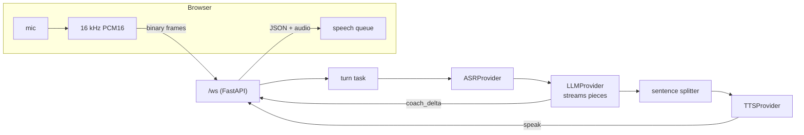

# Voice Coach: a spoken mock-interview coach

The coach asks an interview question out loud, taken from a curated question bank. You answer into your microphone. The app transcribes it, an LLM writes a short follow-up about your answer, and the app speaks it. Controls: start / pause / end, topic and difficulty, a live transcript, and a short end summary.

Built as a portfolio project to practise async Python, WebSockets, provider interfaces, reliability and testing. It is deliberately small: a plain prompt plus conversation history, no RAG, no agent framework, no paid services.

> **Demo mode needs no keys.** The default ASR, LLM and TTS are deterministic fakes. The page labels each fake stage ("FAKE speech recognition", "FAKE coach", "FAKE voice: a beep"). A fake never passes as real.

## Quick start (demo mode)

```bash
python3 -m venv .venv
.venv/bin/pip install -r requirements.txt
.venv/bin/python -m uvicorn backend.main:app
```

Open http://127.0.0.1:8000, choose a topic and difficulty, press Start, then record an answer with the microphone button. With fakes the "transcript" only reflects the audio length, and the coach's questions are canned.

## Real providers (all free)

Nothing loads `.env` automatically yet. Export the variables in your shell. See `.env.example`.

| Stage | Setting | Options | Notes |
|---|---|---|---|
| ASR | `ASR_PROVIDER` | `fake` (default), `whisper` | `whisper` = local faster-whisper (`tiny.en`, int8, CPU). `pip install -r requirements-asr.txt`. Audio stays on the machine; the first call downloads the model |
| LLM | `LLM_PROVIDER` | `fake` (default), `gemini` | Gemini free tier over plain HTTPS + server-sent events. Needs `GEMINI_API_KEY`. Transcripts leave the machine. Never hard-code the key |
| TTS | `TTS_PROVIDER` | `fake` (default, a beep), `browser` | `browser` uses the browser's `speechSynthesis`; the server cannot time it. Voices differ per browser and OS |

Example: `ASR_PROVIDER=whisper LLM_PROVIDER=gemini TTS_PROVIDER=browser GEMINI_API_KEY=... .venv/bin/python -m uvicorn backend.main:app`

## How it works



- **Providers behind small interfaces** (`typing.Protocol`), each with a deterministic fake used by demo mode and tests.
- **Honest streaming:** audio is streamed in, but ASR waits for the whole utterance. The LLM streams its reply to the server, but **follow-ups are not streamed to you**: the reply is a JSON decision that must be complete and valid before anything is said. Then each sentence goes to TTS in turn. (Before the code-owned loop, sentence 1 was spoken while the model wrote sentence 2; that was given up for validation.)
- **State machine** (`session_state.py`): idle, listening, thinking, paused, ended. Every event is checked in one place; history is written only when a reply is complete.
- **Reliability (M4):** each answer runs as a cancellable task so the server keeps reading Pause / End / disconnect. Per-stage deadlines; the LLM is retried once, only before its first piece (a later retry would repeat text the user already saw); a closed tab cancels the work and closes the upstream stream.
- **Question bank and a code-owned loop:** the main questions are curated data (`data/question_bank.json`, validated at startup), spoken word for word with no LLM call and never repeated in a session. After each answer the LLM returns `{"action": "follow_up" | "move_on", "text": ...}`, seeing the question's key points as hidden context. The **code** validates that JSON, caps follow-ups (at most 2, `FOLLOWUPS_PER_QUESTION`; the model is not asked once the cap is reached), and falls back to "Thanks for that answer." plus the next question on invalid output, a timeout or an error. The interview ends by itself after 5/6/8/10 questions (default 6), at the time limit (`INTERVIEW_TIME_LIMIT_S`, default 15 min), or when the bank runs out, or when you press End, then goes through an `ending` state: closing line, summary, closed.
- **Timing:** server stages use `time.perf_counter()`. The browser measures stop-press to first sound on its own clock; the two clocks are never mixed.

Full detail, protocol and per-part status (Planned / Implemented / Verified): [docs/architecture.md](docs/architecture.md). Design decisions and what I learned: [docs/learning-notes.md](docs/learning-notes.md).

## Tests

```bash
.venv/bin/python -m pytest -q
```

236 tests pass at the time of writing (`.venv/bin/python -m pytest -q`, run on 2026-11-03): unit tests, plus WebSocket tests using slow and failing fakes (hung or flaky LLM, hung ASR/TTS, Pause/End mid-reply, disconnect), and the metrics, logging and dashboard tests added in M5. An earlier version of the suite (186 tests) passed in a clean virtual environment built the way CI builds it; the current 236 have not been re-run that way. Note that `tests/test_whisper.py` needs numpy, which comes with `requirements-asr.txt`. The suite has no per-test timeout; if one hangs, run it with `-o faulthandler_timeout=15` to see where.

## Measured (honest numbers)

All numbers are from one Apple M3 laptop (8 cores, 16 GB), with the load generator on the same machine, so they show relative behaviour, not what a dedicated server would do. Full tables, setup and caveats: [docs/performance.md](docs/performance.md).

| What | Result |
|---|---|
| Fake providers, 1 to 100 virtual users, 3 repeats each | 0 failures; throughput grows about linearly to 336-338 req/s; no saturation found. Server stage time at 100 users: `llm_total` p50 4.7-4.8 ms, p95 5.0-5.1 ms (mostly the fake TTS) |
| Real faster-whisper `tiny.en`, 1 to 32 users (fake LLM and TTS, one run per step) | 0 failures, no timeouts. Throughput stops growing at about 4 answers/s. Speech-recognition p50: 242 ms (1 user), 674 ms (8), 2868 ms (16), 7167 ms (32). The speech is one 7.9 s clip made with the macOS `say` voice, **not a human** |
| Whisper cold start (6 fresh servers) | model load 465-577 ms, first transcription 788-898 ms |
| Earlier single samples (M1-M3, not distributions) | Whisper warm call 987.6 ms for 7.3 s of audio; Gemini `gemini-2.5-flash` opener TTFT 3129 ms, total 3283 ms; stop-press to first sound with fake ASR/LLM 52 ms (fake voice), 69 ms (browser voice) |

**Not measured:** real Gemini under load, the whole real pipeline (Whisper + Gemini + voice) end to end, real browser voices under load, memory use. Low-user fake-provider numbers are inflated by an idle-clocked CPU (a 1-user step ran about 3x faster with other cores busy).

## Observability

- `GET /metrics`: JSON with p50/p95 per stage (`asr`, `llm_ttft`, `llm_total`, `first_sentence`, `first_speak`, `tts`), outcome counters and `error_rate`. In memory, per process, no authentication. `METRICS_WINDOW` (default 1000) sets how many recent samples each stage keeps.
- `GET /dashboard`: a small page that polls `/metrics` every 2 s.
- Logs are one JSON object per line, each with the `session_id`. uvicorn's own lines stay plain text.
- Load test: `pip install -r requirements-dev.txt`, then `bash loadtest/sweep.sh 1 10 50 100` (see the header of `loadtest/locustfile.py`).

## Docker

```bash
docker build -t voice-coach .
docker run --rm -p 127.0.0.1:8000:8000 voice-coach      # demo mode, no keys
```

Publish the port on `127.0.0.1` only: `/metrics` has no authentication. To use real providers, pass the same variables as above with `-e` (for example `-e LLM_PROVIDER=gemini -e GEMINI_API_KEY=...`; never put a key in the image). `docker build --build-arg WITH_ASR=1 .` adds local Whisper (large; the model downloads inside the container on first use). **Status: the Dockerfile has not been built yet** (no Docker daemon was running when it was written); see `docs/architecture.md`.

## CI

`.github/workflows/ci.yml` runs on every push and pull request: the test suite on Python 3.13 (installing `requirements-asr.txt` for numpy), and a Docker job that builds the image, starts it and checks `/health`, `/`, `/metrics` and `/dashboard`. **Status: not run on GitHub yet.** The same install and test steps were run in a clean virtual environment locally (186 passed).

## Known limitations

- The deadlines (ASR 30 s, LLM first piece 10 s, LLM total 30 s, TTS 5 s per sentence) are starting guesses, overridable with `TIMEOUT_*` variables. They are not tuned from data.
- A timed-out Whisper call cannot be killed: its worker thread keeps using CPU until it finishes.
- Follow-ups wait for the complete LLM reply before the first word is spoken (validation needs the whole JSON). How much later first sound comes with real Gemini is **not measured yet**.
- How often real Gemini returns invalid decision JSON (and so falls back) is **not measured yet**; the dashboard's "LLM fallbacks" tile counts it, and fallbacks are not in the error rate.
- No fallback providers (for example a second LLM). The only fallbacks are the LLM retry and a text-only reply when TTS fails.
- Tested in VS Code's built-in browser only (probably Chromium, not confirmed). Real Chrome, Safari and Firefox are untested. `speechSynthesis` behaves differently across them.
- The spoken summary is text only. The tail of the audio (under about 43 ms) is dropped when recording stops.
- Not yet verified with real Gemini or Whisper through the M4 task path, and the whole real pipeline has not been timed.
- The question bank has 65 questions in 7 topics, written by me and not reviewed by anyone else; the difficulty labels are my own judgement. Questions are picked at random without repeats; when a topic and level runs out, the coach says so and you press End.
- Not yet run with real Gemini: whether the model keeps to the key points, avoids reading them out, and stays on the question is **unverified** (the fake LLM cannot show it).
- No limits across sessions: under real Whisper, extra users only wait longer (see Measured).

## Project layout

```
backend/
  main.py            FastAPI app, /health, /ws, turn task, SafeSender
  session_state.py   interview state machine (pure)
  reliability.py     deadlines, retry rule, TurnRunner (pure asyncio)
  sessions.py        message builders, utterance buffer
  metrics.py         in-memory p50/p95 per stage, outcome counters (pure)
  logs.py            JSON log lines with the session id (contextvar)
  sentences.py       streaming sentence splitter
  prompts.py         prompts (follow-up with key points, end summary) + history window
  questions.py       curated question bank: load, validate, pick (pure)
  asr/ llm/ tts/     provider interface + fake + real implementations
data/
  question_bank.json the questions: id, topic, difficulty, question, key points
frontend/            index.html (the app) and dashboard.html, plain HTML + vanilla JS
loadtest/            Locust file, sweep/warm-up/summary scripts, raw results
tests/               pytest; fakes with slow / failing modes
docs/                architecture, learning notes, performance, project brief
Dockerfile, .github/workflows/ci.yml
```

## Roadmap

| Module | Status |
|---|---|
| M0 skeleton, M1 mic to ASR, M2 LLM + state machine, M3 TTS + pipeline, M4 reliability | done |
| M5 structured logs, `/metrics`, latency dashboard, load test, baseline report | done |
| M6 Docker, GitHub Actions CI, README numbers | Docker image built and run locally in demo mode (251 MB, healthy, full interview through the container); the GitHub run is pending (no remote yet) |
| Curated question bank (JSON): bank questions, LLM follow-ups, `GET /topics`, topic dropdown | done; two real Gemini sessions checked by hand |
| Code-owned loop: JSON follow_up / move_on decisions with fallback, follow-up cap, automatic ending (count, time, bank), `ending` state | done (279 tests, one real-server run in demo mode); real Gemini run pending |
| Delivery feedback (words per minute, fillers, pauses, answer length), measured and written by code | done (tests, and the detector run on the `say` test clip); real microphone **not validated** |
