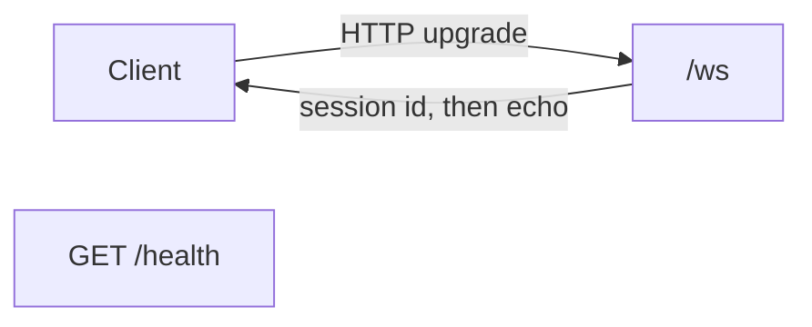
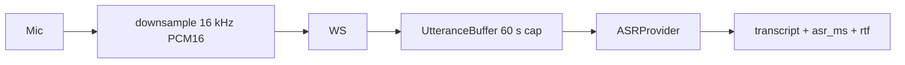
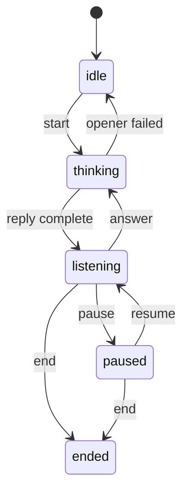
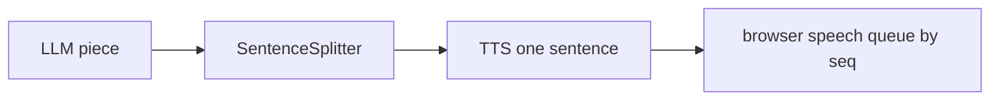
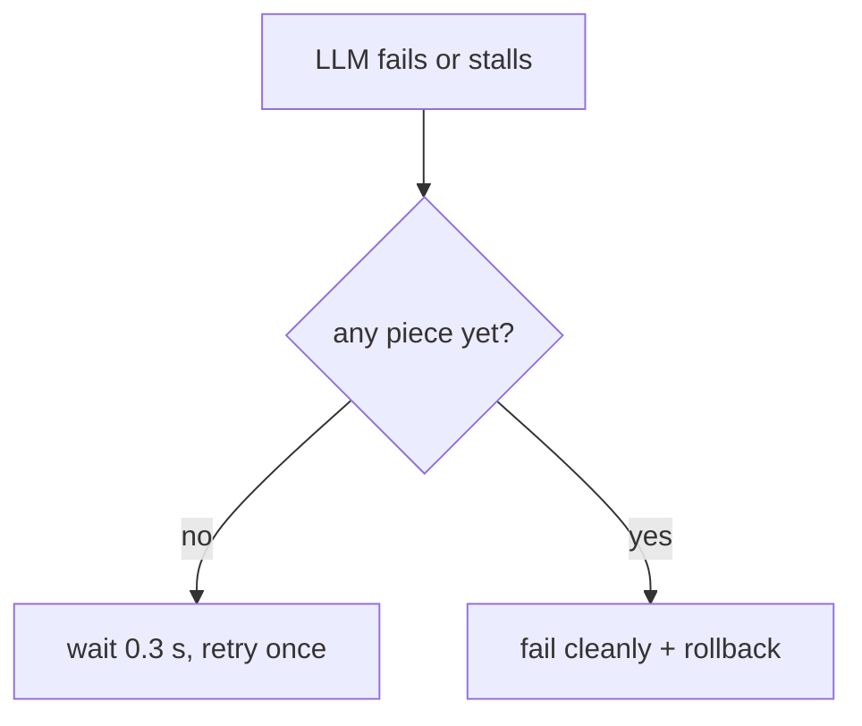

# Project brief: Spoken Mock-Interview Coach

For: me, before a placement interview. Read top to bottom once, then use sections 6 and 8 for revision.
Status date: 2026-11-02. Covers M0 to M4. M5 (metrics, logs, dashboard, load test) and M6 (Docker, CI) are also written; see `docs/performance.md` and the last bullets of section 8.

---

## 1. The project

**In 30 seconds.** A web app where an AI coach asks me an interview question out loud, I answer into my microphone, the app turns my speech into text, an LLM writes a short follow-up, and the app speaks it back. The backend is async Python (FastAPI + WebSockets). Speech recognition, the LLM and the voice each sit behind a small interface, so a deterministic fake can replace any of them for tests and for a no-keys demo mode. The interesting engineering is in timing, cancellation and failure handling, not in the AI.

**In 2 minutes.**
- The browser records the mic, converts it to 16 kHz PCM16 and sends it over one WebSocket.
- The server collects one utterance, runs speech recognition (local faster-whisper), then asks the LLM (Gemini free tier) for a reply. The reply streams in pieces; each complete sentence goes to text-to-speech while the LLM writes the next one.
- A **state machine** (idle, listening, thinking, paused, ended) decides which events are legal. History is saved only when a reply is complete.
- Each answer runs as its own **cancellable task**, so Pause, End and a closed tab work even during a slow reply. Every stage has a **deadline**; the LLM is **retried once**, only before it has produced anything.
- Every stage is timed with a monotonic clock. The browser times "stop press to first sound" on its own clock; the two clocks are never mixed.
- **It is not:** RAG, an agent framework, a general chatbot, or a paid service. Demo mode needs no keys and the page labels every fake.

---

## 2. One interview turn, as it works now

```mermaid
sequenceDiagram
  participant B as Browser
  participant R as Receive loop (/ws)
  participant T as Turn task
  participant A as ASR
  participant S as Session (state machine)
  participant L as LLM
  participant V as Splitter + TTS

  B->>R: utterance_start, binary PCM frames, utterance_end
  R->>R: state allows recording? not busy? buffer complete?
  R->>T: spawn answer_turn (loop keeps reading the socket)
  T->>A: transcribe (30 s deadline; Whisper runs in a thread)
  A-->>T: text
  T-->>B: transcript (asr_ms)
  T->>S: add_user (listening -> thinking)
  T->>L: stream via stream_with_retry (10 s to first piece, 30 s total)
  loop each piece
    L-->>T: piece
    T-->>B: coach_delta
    T->>V: complete sentence? synthesize (5 s each)
    V-->>T: audio or "browser speaks it"
    T-->>B: speak seq N
  end
  T->>S: add_coach (thinking -> listening)
  T-->>B: coach_done (ttft, total, first_speak) + state
  B->>B: play speech queue in seq order
  B->>R: playback_started (stop->sound, browser clock)
  Note over B,R: If Pause/End/disconnect arrives mid-turn: the loop cancels the task, session.cancel_turn() drops the unanswered message, client gets "turn cancelled" and discards partial text + queued speech
```

M5 adds (uncommitted): each stage also records a sample into an in-memory `Metrics` object and log lines carry the session id.

---

## 3. Module by module

### M0 Skeleton

- **Does:** FastAPI app, `/health`, a WebSocket that sends a session id and echoes JSON.
- **Files:** `backend/main.py`, `backend/sessions.py` (`new_session_id`, `build_echo`), `tests/test_app.py`.
- **Key decision:** bad input gets an `error` message and the socket stays open; the id is `uuid4().hex` (unguessable, no shared counter).
- **Can fail:** invalid JSON, non-object JSON -> error message, loop continues.
- **Must explain:** the event loop. `await` yields; one blocking call freezes every session.

### M1 Audio -> speech recognition

- **Does:** streams mic audio in, transcribes the whole utterance, reports timing.
- **Files:** `backend/audio.py`, `backend/asr/{base,fake,whisper}.py`, `UtteranceBuffer` in `sessions.py`, the audio code in `frontend/index.html`.
- **Key decision:** raw PCM16 (no ffmpeg, matches Whisper's input) and local faster-whisper `tiny.en` (audio stays on the machine, free, timeable) over browser Web Speech (Chrome-centric, cloud).
- **Can fail:** audio over 60 s (capped, error once), odd byte count, wrong sample rate, Whisper error -> `transcription failed`.
- **Must explain:** ASR is **not** streaming (needs the full utterance); the model call is blocking, so it runs in `asyncio.to_thread`; the first call is far slower than later ones (cold vs warm).

### M2 LLM follow-up and session state

- **Does:** builds a prompt (system + last 12 messages), streams the reply, keeps history, writes an end summary.
- **Files:** `backend/session_state.py`, `backend/prompts.py`, `backend/llm/{base,fake,gemini}.py`.
- **Key decision:** history is written **only when a reply is complete**; a failed turn removes the unanswered user message so roles keep alternating.
- **Can fail:** missing `GEMINI_API_KEY` (error, then close), HTTP error, malformed event, empty reply (e.g. safety block).
- **Must explain:** a state machine lists legal transitions in one place; TTFT (what the user feels) vs total time.

### M3 Text-to-speech and pipelining

- **Does:** speaks sentence 1 while the LLM is still writing sentence 2.
- **Files:** `backend/sentences.py`, `backend/tts/{base,fake,browser}.py`, speech queue in `frontend/index.html`.
- **Key decision:** the unit is one complete sentence, and `speechSynthesis` in the browser is the real voice (zero install). The fake voice is a labelled beep.
- **Can fail:** TTS error or timeout -> one `speech failed`, text still arrives; LLM failure mid-reply -> client discards text **and** queued speech.
- **Must explain:** the exact streaming claim. Audio streams in, ASR waits, the LLM streams, TTS waits per sentence. And never subtract a browser timestamp from a server one.

### M4 Reliability

- **Does:** deadlines, cancellation, safe retry, cleanup.
- **Files:** `backend/reliability.py` (`Timeouts`, `with_deadline`, `stream_with_retry`, `TurnRunner`), `SafeSender`, `guarded` and `interrupt` in `main.py`.
- **Key decision:** the turn runs as a separate task so the receive loop can still read Pause/End/disconnect. Retry only when repeating is invisible.
- **Can fail:** see the table in section 4 and `docs/architecture.md` ("Reliability (M4)").
- **Must explain:** cancellation is cooperative (`CancelledError` at the next `await`); code that never awaits (a Whisper thread) cannot be cancelled.

---

## 4. Components at a glance

| Component | What it does | Streams or waits | Timeout (default, a guess) | Fallback | How it is tested |
|---|---|---|---|---|---|
| Browser mic capture | records, resamples to 16 kHz PCM16 | streams chunks out | none | none | by hand only; `tests/test_frontend.py` checks element ids |
| `UtteranceBuffer` | collects one utterance | collects | 60 s of audio (size cap) | error once, drop frames | `tests/test_asr_ws.py` |
| ASR (Whisper `tiny.en`) | speech -> text | **waits** for the whole utterance | 30 s | none; user records again. A timed-out thread keeps running | stub-model unit tests; real model by hand (one sample) |
| LLM (Gemini) | writes the reply | **streams** pieces | 10 s to first piece, 30 s total | retry once before the first piece; no second provider | mocked HTTP tests; one real call by hand |
| `SentenceSplitter` | pieces -> sentences | streams per piece | n/a (cuts at 200 chars) | n/a | `tests/test_sentences.py` |
| TTS (fake beep / browser voice) | prepares one sentence | **waits** per sentence | 5 s per sentence | text-only reply | `tests/test_tts.py`, `tests/test_tts_ws.py` |
| Summary | one LLM call over the history | **waits** (not streamed) | 30 s | retry once before output | `tests/test_llm_ws.py`, `tests/test_cancel_ws.py` |
| Session state machine | legal transitions, history | n/a | n/a | rollback on failure | `tests/test_state.py` |
| `TurnRunner` + `SafeSender` | one cancellable task per session; safe sends | n/a | n/a | closed socket -> quiet no-op | `tests/test_cancel_ws.py` |

All deadlines are overridable with `TIMEOUT_*` variables and are **not tuned from data**.

---

## 5. Verified vs pending

| Claim | State | Evidence |
|---|---|---|
| Unit and WebSocket tests (fakes, slow/failing fakes) | **Verified** | `186 passed in 3.50s`, run by Claude on 2026-11-01 (148 are M0-M4; the other 38 are M5 tests) |
| Real uvicorn run, fake providers, full flow in a browser | **Verified (by hand, one session each)** | recorded in `docs/architecture.md`; VS Code's built-in browser only |
| Pause mid-reply and closing the tab on real uvicorn | **Verified (by hand, one session)** | beep stopped, `turn cancelled` shown, `disconnected` logged. Not reported: partial line removal, status text |
| Real Whisper transcript | **Verified once** | 987.6 ms for 7.3 s of audio (warm), 20951 ms first call; single samples |
| Real Gemini call | **Verified once** | `gemini-2.5-flash`: ttft 3129 ms, total 3283 ms; standalone script, single sample |
| Real browser voice heard | **Verified once** | VS Code's built-in browser |
| Whisper + Gemini + voice through the whole pipeline | **Pending** | never run end to end |
| Real Gemini/Whisper through the M4 task path (cancel, retry, timeouts) | **Pending** | |
| Real Chrome, Safari, Firefox | **Pending** | only VS Code's built-in browser was used |
| Timeout values from data | **Pending** | current values are guesses |
| Latency distributions (p50/p95) | **Verified for fakes (3 repeats, 1-100 users) and for real Whisper (1 run, 1-32 users)**; **pending for real Gemini and the whole real pipeline** | `docs/performance.md`; load generator on the same laptop, synthetic `say` voice |
| Fallback providers | **Not built** | |
| Docker image | **Built and run (2026-11-03), demo mode** | see `docs/architecture.md`; the optional `WITH_ASR=1` image is not built |
| GitHub Actions CI | **Run once on GitHub, green (user-reported, 2026-11-03)** | before that, the install + pytest steps passed in a clean virtual environment (186 passed) |
| Curated question bank | **Not built (planned after M6)** | see section 8 |

---

## 6. The 10 most likely interview questions

1. **Why WebSocket and not HTTP?** Audio and replies flow both ways continuously, and the server pushes without being asked. It avoids per-message connection overhead and cuts latency.
2. **Is your pipeline streaming end to end?** Partly, and I can say where. Audio streams in; ASR waits for the full utterance; the LLM streams pieces; a splitter cuts sentences and each complete sentence goes to TTS while the model writes the next one. TTS itself waits per sentence.
3. **What happens if the user presses Pause while the coach is speaking?** The receive loop is free (the turn is a separate task), so it cancels the task, `CancelledError` unwinds and closes the LLM stream, the unanswered message is rolled back, and the client discards partial text and queued speech.
4. **What is safe to retry?** Only what cannot be observed: a failure before the first LLM piece, where nothing reached the client and no history was written. After the first piece a retry would repeat text the user already saw, so I fail cleanly. It is bounded to once and lives in one function.
5. **Why a state machine instead of booleans?** Booleans allow impossible combinations (paused and thinking). The state machine lists legal transitions in one place and is a plain unit test.
6. **Why local Whisper, and does it scale?** Free, private, and timeable on the server. It does not scale by itself: `to_thread` keeps the event loop responsive, but transcriptions compete for the same CPU cores. I would load-test it before claiming any capacity.
7. **How do you measure latency?** `time.perf_counter()` per server stage; the browser measures stop-press to first sound on its own clock. They are separate clocks and I never add or subtract them. I also separate cold start from steady state.
8. **What happens when the client disconnects mid-reply?** The `finally` block in the handler cancels the task and discards the buffer; `SafeSender` returns False for a closed socket so nothing raises; the LLM HTTP stream is closed.
9. **How do you test without real providers, and keep fakes honest?** Each stage has a deterministic fake (with slow, failing and hanging modes). Every fake labels itself in the protocol and the UI, so a fake never passes as real. Real providers are tested with mocked HTTP and a few by-hand runs.
10. **What would you change first to scale this?** Run ASR in a separate process (a thread cannot be killed), decouple TTS from the LLM loop with a queue, add a second LLM provider as a fallback, and put limits across sessions. I would let load-test data pick the order.

---

## 7. What to test myself, live (mic and real providers)

All commands run from the project folder. Stop the server with Ctrl+C. **Nothing below has been run end to end yet; record what you see.**

**A. Demo mode (no keys)** - check the page labels every fake.
```bash
.venv/bin/python -m uvicorn backend.main:app
```
Open http://127.0.0.1:8000, Start, record an answer. Expect: FAKE banners, a beep, a canned follow-up.

**B. Real microphone, real Whisper (no Gemini)**
```bash
.venv/bin/pip install -r requirements-asr.txt
ASR_PROVIDER=whisper .venv/bin/python -m uvicorn backend.main:app
```
First answer downloads the model (slow, expected). Speak a sentence. Expect: the transcript matches what you said; `asr_ms` is shown; the second answer is much faster.

**C. Real Gemini + browser voice**
```bash
export GEMINI_API_KEY=...   # never commit it
LLM_PROVIDER=gemini TTS_PROVIDER=browser .venv/bin/python -m uvicorn backend.main:app
```
Expect: the coach opener is spoken in the browser's voice; follow-ups reference what you said.

**D. The whole real pipeline**
```bash
ASR_PROVIDER=whisper LLM_PROVIDER=gemini TTS_PROVIDER=browser GEMINI_API_KEY=... .venv/bin/python -m uvicorn backend.main:app
```
Note the browser's "stop -> sound" time and the server's `coach_done` fields. Record them as single samples.

**E. Reliability by hand**
```bash
FAKE_LLM_DELAY_S=1 .venv/bin/python -m uvicorn backend.main:app
```
Press Pause mid-reply: speech stops, `turn cancelled` appears, status is `paused`; Resume and answer again. Close the tab mid-reply: the server logs `disconnected` and no traceback.

**F. Timeouts**
```bash
TIMEOUT_LLM_FIRST_S=0.5 FAKE_LLM_DELAY_S=2 .venv/bin/python -m uvicorn backend.main:app
```
Expect: `coach reply timed out` after the one retry.

**G. Tests**
```bash
.venv/bin/python -m pytest -q
.venv/bin/python -m pytest -q -o faulthandler_timeout=15   # if a test hangs
```

**H. Metrics and dashboard**
Run any of A-F, open http://127.0.0.1:8000/dashboard in a second tab, then answer once in the main page. Expect the `asr` row to show n = 1 and `Turns ok` to go up. `curl -s http://127.0.0.1:8000/metrics` shows the same data as JSON. Stop the server: the page should show "Cannot read /metrics" and keep the last numbers.

**I. Docker (never built yet)**
Start Docker Desktop and wait until `docker info` works, then:
```bash
docker build -t voice-coach .
docker run --rm -p 127.0.0.1:8000:8000 voice-coach
```
Open http://127.0.0.1:8000 and run step A. In another terminal: `docker ps` should show the container as `healthy` after about 10-40 s. Record the exact errors if the build fails.

**J. Load test (optional, takes minutes)**
```bash
.venv/bin/python -m pip install -r requirements-dev.txt
bash loadtest/sweep.sh 1 10 50
.venv/bin/python loadtest/summarize.py
```
Keep the laptop idle meanwhile. Compare with `docs/performance.md`; your machine will differ.

---

## 8. Known weaknesses and honest limits (do not overclaim)

- **Questions are written by the LLM**, including the opener. A curated JSON question bank (topic, difficulty, key points; the LLM only writes follow-ups and feedback) is a **planned feature, not built**, scheduled after M6. Delivery feedback (words per minute, fillers, pauses) is a stretch goal after that.
- **No fallback provider.** Only: retry the LLM once, and a text-only reply when TTS fails.
- **Whisper threads cannot be cancelled.** An ASR timeout abandons the result but the thread keeps using CPU until done (audio is capped at 60 s).
- **TTS runs inline** in the LLM stream loop, so a slow server-side TTS delays reading the LLM and is included in `llm_total_ms`.
- **Timeouts are guesses.** No real-provider latency distribution exists yet.
- **Only one browser tested** (VS Code's built-in one, probably Chromium, not confirmed). `speechSynthesis` differs a lot between browsers.
- **A permanent LLM error (bad key) is retried too**, wasting about 0.3 s, because the retry cannot see the error type.
- **Single process, in memory.** A restart loses all sessions. No limits across sessions, no auth.
- **The spoken summary is text only.** The last ~43 ms of audio is dropped when recording stops.
- **`.env` is not loaded automatically**; variables must be exported.
- **`TestClient` is not the real network layer.** A passing suite once hid a missing `websockets` install; that is why by-hand runs on real uvicorn matter.
- **M5 (done, committed):** `/metrics` has no authentication; metrics are per process and cleared on restart. Load tests ran the load generator on the same laptop as the server, closed-loop, 60 s per step. Real Whisper plateaus at about 4 answers per second (asr p50 674 ms at 8 users, 7167 ms at 32, no failures); I have a guess about why (one transcription at a time) but have not tested it. Gemini under load and the whole real pipeline were **not** measured. The 100-user hang during load testing was a bug in my test script (`ws.close()` swallowing Locust's kill), fixed and described in `PROGRESS.md`.
