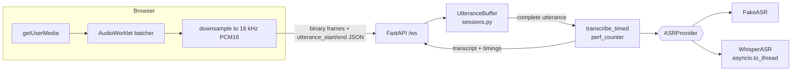
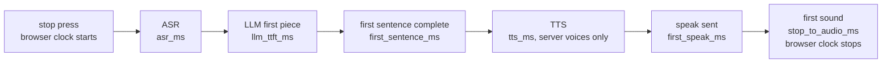
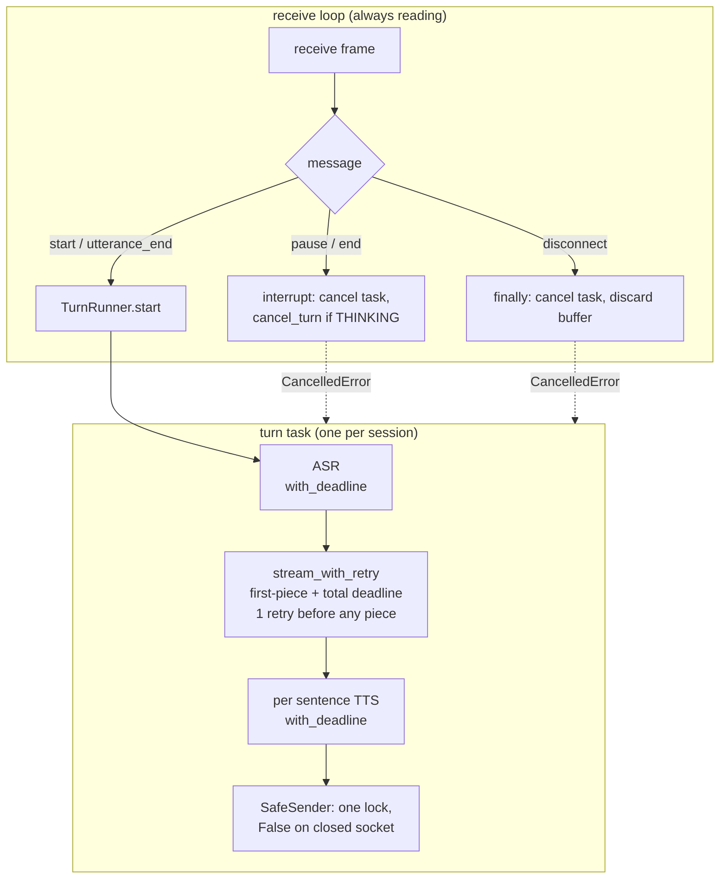
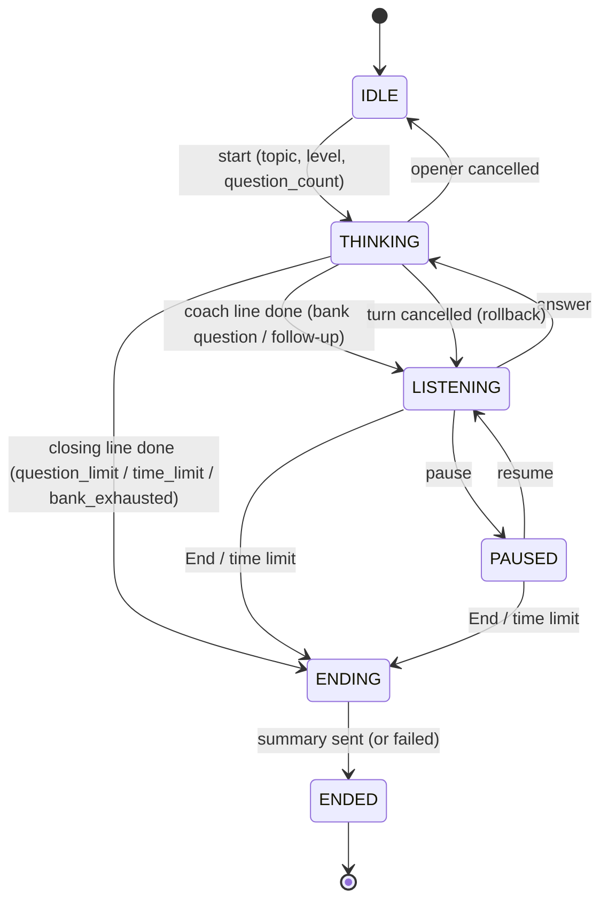
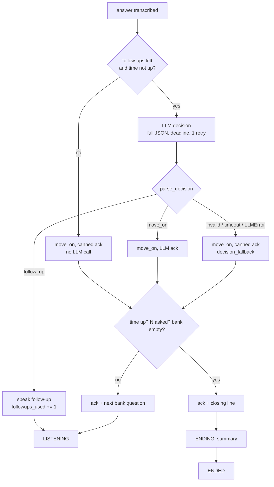
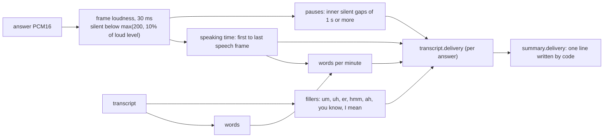

# Architecture

Status key: **Planned** / **Implemented** (code exists) / **Verified** (tests run and passed, or run by hand with the result recorded).

## System as of M3 (the diagram below shows the M1 audio path; the M3 reply path is under "Reply path and latency budget")

| Part | Status | Notes |
|---|---|---|
| `GET /health` | Verified | `tests/test_app.py::test_health` |
| `GET /` serves `frontend/index.html` | Verified | `tests/test_frontend.py`; page used by hand |
| `WS /ws` session id, JSON echo, error replies | Verified | M0 tests |
| Real uvicorn server run by hand | Verified | needed `websockets` installed (added to `requirements.txt`); TestClient could not catch this |
| PCM16 validation (`audio.py`) | Verified | `tests/test_audio.py` |
| `ASRProvider` interface, `FakeASR`, provider selection | Verified | `tests/test_audio.py`, `tests/test_whisper.py` |
| Utterance protocol + per-chunk size cap + timing | Verified | `tests/test_asr_ws.py` |
| Browser mic capture + 16 kHz resample (fake provider) | Verified (by hand) | user-reported working; `audio_ms` matched the time recorded |
| `WhisperASR` (faster-whisper `tiny.en`, int8, CPU) | Verified | unit tests with a stub model; real model run by hand, transcript correct |
| Whisper latency numbers | Partial | M1 single samples (see `learning-notes.md`); M5 added a load run, see `docs/performance.md`: warm one-user decode 242 ms for 7.9 s of synthetic speech, cold first transcription 788-898 ms, throughput plateau about 4 answers/s |
| Streaming ASR | Not planned for M1 | ASR waits for the complete utterance; audio is streamed *in*, text is not streamed *out* |
| Tail of audio (< ~43 ms) dropped at stop | Known limitation | worklet buffer is not flushed on stop |
| `.env` auto-loading | Planned | env vars must be exported in the shell for now |
| `LLMProvider` interface, `FakeLLM`, `prompts.py` (M2 piece 1) | Verified | `tests/test_llm.py`; the fake labels itself and its summary as fake |
| `InterviewSession` state machine (M2 piece 1) | Verified | `tests/test_state.py`; pure, not yet wired to `/ws` |
| `GeminiLLM` streaming (M2 piece 2) | Verified | mocked-HTTP tests (`tests/test_gemini.py`) plus one real call by hand: `gemini-2.5-flash` accepted, reply arrived in 2 pieces |
| WS wiring: start/pause/resume/end, `coach_delta`, TTFT + total timing, summary (M2 piece 3) | Verified (fake LLM only) | `tests/test_llm_ws.py`; in M2/M3 pause/end waited for the turn to finish (inline await). **Superseded by M4**: they now cancel the turn (see the M4 rows). Two tests here were changed in M4 so their injected failure outlasts the retry |
| Recording allowed in `idle` (M1 transcribe-only) and `listening` | Implemented | keeps M1 behaviour; rejected while paused/thinking/ended |
| Frontend controls + transcript (M2 piece 4) | Verified (by hand, fake providers) | user-reported: start, opening question, one spoken answer, follow-up, end, summary all worked with the FAKE banner. Pause/resume in the browser **not reported**. `tests/test_frontend.py` only checks control ids |
| Real Gemini latency (M2) | Partial | one sample: ttft 3129 ms, total 3283 ms (standalone script, opener prompt, user's machine and network). Distribution **pending** (M5). Not yet run through `/ws` in the browser, and pause/resume in the browser not reported |
| `SentenceSplitter` (M3 piece 1) | Verified | `tests/test_sentences.py` (9). Small abbreviation list; "J. Smith" would split wrongly |
| `TTSProvider`, `FakeTTS` (labelled beep), `BrowserTTS` (text only), `TTS_PROVIDER` selection (M3 piece 2) | Verified | `tests/test_tts.py` (9) |
| WS wiring: `speak` per sentence, `first_sentence_ms` / `first_speak_ms`, one `speech failed` error per turn, `playback_started` (M3 piece 3) | Verified (tests, fake/scripted providers) | `tests/test_tts_ws.py` (14): order, speech starts before the LLM finishes, TTS failure keeps text and history, LLM failure mid-reply does not speak the tail |
| Frontend speech queue, cancel rules, per-stage FAKE labels, browser-clock `stop->audio` (M3 piece 4) | Verified (by hand, one session each) | user-reported: fake beep heard, real browser voice heard, opener spoken without an extra click, voice cut off mid-sentence by Pause / Start recording, pause + resume worked. Browser: VS Code's built-in browser, user guessed Chromium ("chrome i guess"), **not confirmed**. Real Chrome, Safari, Firefox: **not tested** |
| TTS runs inline in the LLM stream loop | **No longer true (2026-11-03)** | was a known limitation: a slow server-side TTS delayed reading the next LLM piece, and `llm_total_ms` included it. Since the code-owned loop, the decision JSON is collected complete first and TTS runs after it (`Speaker` in `main.py`), so `llm_total_ms` no longer includes TTS. Numbers measured before this date (M3 budget table, `docs/performance.md`) were taken with the old coupling and are not comparable |
| Streaming claim (M3) | Stated precisely | LLM -> splitter -> TTS dispatch is per piece / per sentence. Each TTS call waits for one **complete sentence**; not token-level TTS. ASR still waits for the full utterance |
| Spoken summary | Not done | the end summary is text only |
| Piper (server-side TTS) | Not planned for M3 | the interface allows it later (`SpokenChunk.audio` carries bytes) |
| Real Whisper + Gemini + voice through the whole pipeline | Pending | the only M3 pipeline samples used the fake ASR and LLM (see budget table) |
| Latency budget (M3) | Partial | table below: two single samples with fake upstream stages; real numbers **pending** |
| Deadlines per stage (`Timeouts`, `with_deadline`, `StageTimeout`) (M4 piece 1) | Verified | `tests/test_reliability.py`; values are env-overridable starting guesses, not measurements |
| LLM retry once, only before the first piece (`stream_with_retry`) (M4 piece 1) | Verified | `tests/test_reliability.py`, `tests/test_cancel_ws.py`; a permanent error (bad key) is retried too and costs 0.3 s |
| `TurnRunner`, `InterviewSession.cancel_turn` (M4 pieces 1-2) | Verified | unit tests |
| Turn task + `SafeSender` + disconnect cleanup in `main.py` (M4 piece 3) | Verified (tests, TestClient, fake providers) | `tests/test_cancel_ws.py` (14): pause/end mid-reply, pause during ASR, busy, hung LLM/ASR/TTS/summary, flaky LLM, unexpected error, disconnect releases the LLM stream |
| Pause / End buttons enabled while thinking (M4) | Implemented | `frontend/index.html` `refresh()`; `tests/test_frontend.py` only checks control ids |
| Real uvicorn run of M4, fake providers, `FAKE_LLM_DELAY_S=1` (Pause during a slow reply; close the tab mid-reply) | Verified (by hand, one session, user-reported) | Pause mid-reply: the beep stopped and an `error: turn cancelled` line appeared. Resume then a new answer: normal reply. Closing the tab mid-reply: the server logged `disconnected`. **Not reported:** whether the partial coach line disappeared, whether the status read `paused`, and whether the log had a traceback or a `client gone` line. Browser not recorded. Real Gemini/Whisper through the task path: **pending** |
| Whisper worker thread cannot be cancelled | Known limitation | an ASR timeout abandons the result, but the thread keeps using CPU until it finishes; audio is capped at 60 s. Real fix = a subprocess, out of scope |
| No fallback provider (e.g. LLM -> second LLM, server TTS -> browser) | Not done | the only "fallbacks" are: retry once (LLM), text-only reply (TTS failure) |
| Cross-session limits, queueing under load | Measured, not implemented | under real Whisper, throughput plateaus at about 4 answers/s and asr p50 grows 674 ms (8 users) -> 7167 ms (32 users) with 0 failures and no timeouts (`docs/performance.md`). There is still no limit or queue policy in the app |
| `Metrics` registry (p50/p95 per stage, outcome counters) and `GET /metrics` (M5 pieces 1-2) | Verified (tests) | `tests/test_metrics.py` (12), `tests/test_metrics_ws.py` (8); **uncommitted**. Window = newest 1000 samples per stage. `/metrics` is open, no auth. Summary failures are not counted in `error_rate`. A failed turn records no latency sample |
| JSON logs with `session_id` via contextvar (M5 piece 3) | Verified (tests + by hand) | `tests/test_logs.py` (8). Real uvicorn run (fake providers): the same `session_id` on every `voice_coach` line. uvicorn's own lines stay plain text and carry no id |
| `GET /dashboard` (M5 piece 4) | Verified (tests); by hand partly | `tests/test_dashboard.py` (4). By hand: dark mode fine, the "cannot read /metrics" banner appears when the server stops. The `asr` row filling on screen after a spoken answer: not confirmed |
| Load test: Locust + `loadtest/sweep.sh` + `warmup.py` + `summarize.py` (M5 piece 5) | Verified (by running) | fake providers 1/10/50/100 users x 3 repeats, 0 failures; real Whisper 1-32 users, 0 failures. Load generator on the same laptop. The earlier 100-user shutdown hang was a test-tool bug (`ws.close()` swallows Locust's kill; fixed with `ws.shutdown()`); 24 of 24 runs since exited by themselves. Real Gemini under load: not planned. Whole real pipeline under load: pending |
| Question bank: `question_bank.json` (86 questions, 7 topics; 65 until 2026-11-10), `questions.py` load/validate/pick (bank piece 1) | Verified (tests) | `tests/test_questions.py` (23): valid file, every topic has all 3 levels with at least 2 questions, bad entries and duplicate ids rejected. Content written by me, **not reviewed by anyone else**; difficulty labels are my judgement |
| Bank-driven turns: `TurnPlan`, `plan_turn`, commit in `add_coach`; bank question spoken with no LLM call; LLM follow-ups (2 per question, `FOLLOWUPS_PER_QUESTION`); wrap-up line when a topic and level runs out; `GET /topics`; topic dropdown (bank piece 2) | Verified (tests + one real uvicorn run, fake providers) | `tests/test_state.py`, `test_llm_ws.py`, `test_cancel_ws.py`, `test_tts_ws.py`, `test_metrics_ws.py`, `test_llm.py`, `test_frontend.py`: 236 passed in total. Real server run (port 8001, demo mode): turns went bank, fake, fake, bank, fake; unknown topic rejected in tests. The dropdown in a browser: **not seen**. **Superseded (2026-11-03):** `plan_turn`, the fixed follow-up count and the wrap-up line were replaced by the code-owned loop (section below) |
| Follow-up prompt with key points; summary prompt lists the questions asked | Verified (by hand, 2 real Gemini sessions, user-reported) | Run 1 (data structures): one follow-up per turn, key points not read out, summary had the 4 parts and asked no question. It wrongly counted an unanswered last question against the candidate and stated a guess about a garbled sentence, so two rules were added to the summary system prompt (`backend/prompts.py`). Run 2 (operating systems, "I don't know" answers, last coach question unanswered): no mention of the unanswered question, no claim built on garbled words. One sample per case, not a distribution. Topic name is still only implied in the summary. Observed, not fixed: an answer cut off mid-sentence ("a thread is a unit of...") got a follow-up on the half answer |
| Bank turns have no LLM timing | Stated | `coach_done.llm_ttft_ms` / `llm_total_ms` are `null` for bank lines and `llm_ttft` / `llm_total` metrics get no sample, so those stages now count only follow-ups. Earlier numbers in `docs/performance.md` measured LLM-written openers and are not changed |
| Baseline report `docs/performance.md` and M5 learning notes (M5 piece 6) | Implemented | measured numbers only; open items listed in the report. `METRICS_WINDOW` (env, default 1000) lets a load test keep every sample of a step |
| Curated question bank (JSON: topic, difficulty, key points; the LLM writes only follow-ups and feedback) | Implemented (see the bank rows above) | `data/question_bank.json` (86 questions, 7 topics; 65 until 2026-11-10; moved from `backend/`, data is not code) loaded by `backend/questions.py`; the opener is a bank question, the LLM writes only follow-ups and the summary. Difficulty labels are the author's judgement, not reviewed yet. Stretch after that: delivery feedback from measurable signals only (words per minute, fillers, pauses, length), **Planned** |
| Demo mode from a clean environment (M6) | Verified (by running) | a fresh virtual environment with only `requirements.txt`: `faster_whisper` not importable, app starts, `/health`, `/`, `/metrics`, `/dashboard` return 200, a WebSocket opener finishes with fake providers. This is the closest local stand-in for the container |
| `Dockerfile`, `.dockerignore` (M6) | Verified (by running, 2026-11-03; demo mode only) | python:3.13-slim, non-root user, `HEALTHCHECK` on `/health`, demo mode by default. `docker build -t voice-coach .` took 25 s on an Apple-silicon laptop (aarch64, Docker 29.8.1, first build: the base image and pip layers were fetched), image 251 MB. Run with `-p 127.0.0.1:8000:8000`: `/health`, `/topics`, `/`, `/dashboard` returned 200; `docker inspect` health went `healthy` within 8 s; the process ran as uid 10001; `/app` held no `.env`; one full demo interview (start, answer, End) reached `ended` through `ending` with `bank` and `fake` providers, 0 error lines in the container log. **Not done:** the optional `--build-arg WITH_ASR=1` image (large, downloads a Whisper model), an `amd64` build, and the same build on GitHub Actions |
| `.github/workflows/ci.yml` (M6) | Verified (one run on GitHub, user-reported 2026-11-03: green tick on the Actions page for the first push of `question-loop`) | per-job results, durations and the run number were **not reported**. Before that the recipe had only been run locally. The YAML parses (2 jobs: `test`, `docker`). The `test` job's install and pytest steps were run in a clean virtual environment: 186 passed. Action versions (`checkout@v4`, `setup-python@v5`) not checked against current releases. The load test is not part of CI |
| `pytest` listed in `requirements.txt` | Known imperfection | it is installed in the image although the app does not need it; splitting it out was not worth a new file yet |
| Summary prompt (fix, 2026-11-02) | Fixed; verified by tests only | real Gemini answered the old summary request with another interview question, because the request ended with the coach's own turn and the instruction was only in the system prompt. Now a final user turn asks for four parts (Summary, Strengths, Areas to improve, Practice next), and the system prompt names the session's topic and difficulty so the answers are judged against the level. `tests/test_llm.py` asserts every prompt ends with a user turn and roles alternate; `tests/test_llm_ws.py` checks the prompt the LLM receives over `/ws` carries the topic and difficulty. **Not yet re-run against real Gemini** |
| Real runs by hand, user-reported (2026-11-02) | Partly verified | demo mode with the microphone: all clear. Dashboard: `Turns ok` rises, 'cannot read /metrics' appears when the server stops. Real Whisper + microphone: transcript correct (asr_ms not reported). Real Gemini after fixing the key: replies worked. Pause / End / disconnect with `FAKE_LLM_DELAY_S`: passed. One run used the FAKE ASR by mistake (transcripts read 'fake transcript (N ms of audio)'), so it was not the whole real pipeline |
| Stop press -> first sound with a real LLM, user-reported single samples | Partial | fake ASR + Gemini + browser voice: 2507 ms and 2455 ms. Later run (ASR provider not confirmed in the pasted lines): 2041 ms, then 1815 ms. One server line from that run: ttft_ms 1615, first_speak_ms 1616, total_ms 1830. Summary call: total_ms 1226. Single samples on one machine, not a distribution; the whole pipeline with confirmed Whisper is still pending |

## WebSocket message protocol

Server -> client on connect: `{"type":"session","session_id":"<hex>"}`

Client -> server:
- `{"type":"utterance_start","sample_rate":16000}` (only 16000 accepted)
- binary frames: raw PCM16 little-endian mono
- `{"type":"utterance_end"}`
- `{"type":"start","topic","difficulty","question_count"}` (difficulty: easy/medium/hard; `question_count`: 5, 6, 8 or 10, default 6 when omitted), `{"type":"pause"}`, `{"type":"resume"}`, `{"type":"end"}`
- any other JSON object: echoed (M0 behavior)

Server -> client:
- `{"type":"transcript","session_id","text","provider","audio_ms","asr_ms","rtf"}`; `provider` is `fake` or `faster-whisper`
- `{"type":"state","session_id","state"}`: idle / listening / thinking / paused / ending / ended (`ending`: closing line and summary in progress, nothing else accepted)
- `{"type":"coach_delta","session_id","text"}` (since the code-owned loop: **one delta with the whole line**; follow-ups are validated JSON and no longer streamed), then `{"type":"coach_done","session_id","text","provider","llm_ttft_ms","llm_total_ms"}`; on failure an `error` follows and the client must discard unfinished deltas. `provider` is `bank` (scripted line, no LLM call), `fallback` (the LLM failed, timed out or gave invalid output: canned acknowledgement), or the LLM name
- `{"type":"summary","session_id","text","provider","end_reason","llm_ttft_ms","llm_total_ms"}`: sent once complete, not streamed; `provider` is `none` when no answers were recorded; `end_reason` is `question_limit` / `time_limit` / `bank_exhausted` / `manual`. A `state: ended` follows it
- `{"type":"speak","session_id","seq","text","provider","tts_ms"}` plus `mime` and `audio_b64` when the server synthesised audio (`fake`); `provider` is `fake` or `browser`; `tts_ms` is `null` for `browser` (the server did no synthesis). One per sentence, in `seq` order, sent before `coach_done`. After an `error` with reason `coach reply failed` the client must discard queued speech as well as unfinished deltas
- `coach_done` also carries `tts_provider`, `first_sentence_ms` (turn start -> first complete sentence) and `first_speak_ms` (turn start -> first `speak` sent, `null` if nothing was spoken); server clock
- `{"type":"echo","session_id","data","server_ts"}`
- `{"type":"error","session_id","reason"}`; the connection stays open

Client -> server (M3): `{"type":"playback_started","stop_to_audio_ms":<0..600000>}`, sent once per answer when sound actually starts. Measured on the **browser** clock (stop press -> first audible sound); the server only logs it and never subtracts it from server timings. No reply on success; invalid values get an `error`.

Error reasons: `invalid JSON`, `JSON must be an object`, `audio received before utterance_start`, `utterance_end without utterance_start`, `no audio received`, `PCM16 data must have an even number of bytes`, `sample_rate must be 16000`, `utterance already in progress; ...`, `utterance longer than 60s` (sent once, further frames dropped until `utterance_end`), `transcription failed`, `coach reply failed`, `summary failed`, `LLM unavailable: ...` (connection then closes), `cannot <event> while <state>`, `empty answer`, `no speech recognized, please try again`, topic/difficulty validation messages, `speech failed` (sent once per turn; the text and history are unaffected and sentences already queued still play), `stop_to_audio_ms must be a number between 0 and 600000`.

Added in M4: `transcription timed out`, `coach reply timed out`, `summary timed out`, `turn cancelled` (Pause/End interrupted a running turn; the client discards partial text and queued speech, like for `coach reply failed`), `internal error` (an unexpected exception inside a turn; logged with a traceback; the session stays usable), `busy: the previous request is still being processed` (a second utterance or `start` while ASR or a turn is running). A cancelled opener returns the session to `idle`, so Pause then also reports `cannot pause while idle`, preceded by a `state` message.

Since the code-owned loop (2026-11-03): `coach reply failed` and `coach reply timed out` are no longer sent, because an LLM problem during a decision falls back to move_on. New: `question_count must be one of 5, 6, 8, 10`.

## Reply path and latency budget (M3)

Server stages use `time.perf_counter()`; `first_sentence_ms` and `first_speak_ms` count from the start of `coach_turn` (after ASR). The last row uses the browser's `performance.now()`. The two clocks are never added or subtracted.

Measured, user's machine (macOS; hardware not recorded), one session per column, **single samples, not a distribution**. ASR and LLM were the fakes, so these are an overhead floor, not the real pipeline:

| Stage | Where | Fake voice (beep) | Browser voice | Real pipeline |
|---|---|---|---|---|
| ASR | server | 0 ms (fake) | 0.1 ms (fake) | earlier M1 sample: 987.6 ms for 7.3 s audio, faster-whisper `tiny.en`; not re-run in M3 |
| LLM first piece | server | 0.1 ms (fake) | 0.1 ms (fake) | earlier M2 sample: 3129 ms, Gemini, standalone; not re-run in M3 |
| First sentence complete (from turn start) | server | 1 ms | 0.8 ms | pending |
| TTS synthesis | server | not shown in the UI (`tts_ms` is in the `speak` message) | n/a (no server synthesis) | pending |
| First `speak` sent (from turn start) | server | 18.3 ms | 0.9 ms | pending |
| LLM total | server | 18.3 ms | 0.9 ms | pending |
| Stop press -> first sound | **browser** | 52 ms | 69 ms | pending |

Reading the table:
- `llm_total_ms` (18.3 vs 0.9 ms) differs between the columns by about the fake TTS cost. This is consistent with TTS running inline in the stream loop, but it compares two different runs and is **not** an isolated measurement.
- With ASR and LLM at about 0 ms, the 52 / 69 ms in the last row is browser-side start-up (audio element or speech engine) plus a few ms of localhost. It says nothing about the real total.
- The first sound waits for the first *complete sentence*, so with a real LLM the budget is dominated by ASR + LLM TTFT + time to finish sentence 1. Targets are not set until real numbers exist (M5).

## Reliability (M4)

| Failure | What happens | Retried? |
|---|---|---|
| ASR error / timeout | `transcription failed` / `transcription timed out`; state unchanged; user records again | no |
| LLM error / timeout **before** the first piece | one retry after 0.3 s; invisible to the client if it works. If the retry fails too: fallback move_on (since 2026-11-03) | yes (once) |
| LLM error / timeout **after** the first piece | since 2026-11-03: fallback move_on with the canned acknowledgement, counted as `decision_fallback` (was: `coach reply failed` + rollback) | no (rule kept, although pieces are no longer shown, so a retry would now be safe) |
| LLM reply is not a valid decision (not JSON, unknown action, empty / too long text, key point copied) | fallback move_on, `decision_fallback`; the raw reply (first 200 chars) is logged | no |
| TTS error / timeout | `speech failed` once; rest of the reply is text only | no |
| Summary error / timeout | `summary failed` / `summary timed out`; the session is `ending` and still moves to `ended` | once, before any output (same rule) |
| Pause / End during a turn | task cancelled, `turn cancelled`, unanswered message dropped, then the event applies | n/a |
| Pause / End while `ending` or `ended` | rejected; the closing line and summary task are left running | n/a |
| Time limit reached | watchdog task: a running turn is cancelled and rolled back (like End), then `ending` with `end_reason: time_limit` | n/a |
| Client disconnect | `finally` cancels the task; the LLM HTTP stream is closed | n/a |
| Unexpected exception in a turn | `internal error`, logged with traceback, rollback, session usable | no |

Default deadlines (guesses, env-overridable; only real sample so far: Gemini TTFT 3129 ms once): ASR 30 s, LLM first piece 10 s, LLM total 30 s, TTS 5 s per sentence, summary 30 s.

## Code-owned interview loop (2026-11-03)

The code decides the structure of the interview; the LLM only chooses `follow_up` or `move_on` and writes that one line.

| Part | Status | Evidence |
|---|---|---|
| Bank file `data/question_bank.json`, validated at startup (`load_bank`, `QuestionBankError`) | Verified (tests + real uvicorn) | `tests/test_questions.py`; a pinned-path test keeps the loader and the Dockerfile's `COPY data` in step. Real server on port 8003 served all 7 topics from `/topics` |
| `parse_decision` (`backend/decision.py`): JSON object, known action, non-empty text of at most 400 chars, no key point copied word for word | Verified (tests) | `tests/test_decision.py` (15). The key-point check only catches verbatim copies; a paraphrase passes, so the prompt is still the main defence |
| State machine: `ENDING`, `EndReason`, `plan_opening`, `needs_decision`, `plan_move_on`, `begin_ending`, `finish`; `question_count` in {5, 6, 8, 10}, default 6; time limit default 900 s, pauses included | Verified (tests) | `tests/test_state.py`: each end condition with an injected clock, the follow-up cap, no repeats, nothing but `finish` accepted while ending |
| Loop wired in `main.py`: `decide` (fallback on invalid / timeout / error), `coach_turn`, `closing_turn`, `finish_interview`, time-limit watchdog task | Verified (tests + one real uvicorn run, fake providers) | `tests/test_llm_ws.py` (23): seeded order without repeats, cap of 2, each end condition, bad output x4, LLM error, LLM timeout. Full suite: **279 passed in 3.80s**. Real uvicorn, `INTERVIEW_TIME_LIMIT_S=2`: answered once, then the watchdog fired at 2.00 s: `ending`, closing line, summary with `end_reason: time_limit`, `ended`; no traceback in the log |
| Follow-ups no longer streamed to the client | Stated (trade-off) | the decision is spoken only after the full JSON arrived and passed validation, so `first_speak_ms` for a follow-up now includes the whole LLM reply. `tests/test_tts_ws.py` pins this (one delta per line). **Effect on real latency: pending** (needs a real Gemini run) |
| `decision_fallback` counter and dashboard tile | Verified (tests) | a fallback turn is `turn_ok` (the candidate got a reply) and is **not** in `error_rate`; LLM trouble shows in this counter instead. `tests/test_metrics_ws.py`, `tests/test_dashboard.py` |
| Frontend: question-count picker, `ending` state ("wrapping up…"), end reason above the summary | Implemented (string tests only) | `tests/test_frontend.py`. **Not seen in a browser yet** |
| Real Gemini returning valid decision JSON | Partial (one real session, user-reported, 2026-11-03) | Python basics: 3 decision calls; 2 valid (one follow_up, one move_on with Gemini's own text), **1 fallback** (`decision_fallback: 1` in `/metrics`). All 3 calls returned a complete reply (`llm_total` n = 3), so the fallback was an *invalid* reply, not a timeout or error. **Why it was invalid: pending** (the `invalid reply` log line was not captured yet). Key points were not spoken; the summary had the 4 parts and called a garbled answer unclear |
| Cost of not streaming follow-ups, real Gemini | Measured once (3 calls, one session) | `llm_ttft` p50 2183 ms, `llm_total` p50 2197 ms: Gemini sent the short JSON almost in one go, so waiting for the complete reply cost about 14 ms at the median here. A small sample on one machine and network, not a distribution |
| Borrowing from adjacent levels (`levels_by_distance`, `pick_question`) | Verified (tests) | found in the real run above: it ended after 2 questions with `bank_exhausted`, because every topic and level has only 2-6 questions. Now the chosen level comes first, then the nearest other level (ties go easier), always on the same topic; each question keeps its own level for the decision and summary prompts. `tests/test_questions.py`, `tests/test_llm.py`; 286 passed. **Still limited by content:** Python basics, Data structures, Databases and SQL have 6 questions in total and Computer networks 9, so 8 or 10 questions end early there with `bank_exhausted` |

## Delivery feedback (stretch, 2026-11-03)

Measurable signals only; no tone or emotion analysis.

| Part | Status | Evidence |
|---|---|---|
| `backend/delivery.py`: `analyze`, `speech_frames`, `count_fillers`, `session_line` (pure, no numpy) | Verified (tests) | `tests/test_delivery.py` (15) with synthetic tones and silence: pauses, trimmed leading/trailing silence, short gaps ignored, quiet microphone, filler word boundaries. 60 s of audio analysed in 28 ms (one run, this laptop) |
| Per-answer numbers in `transcript.delivery`; stats stored with each user message and rolled back with it; `summary.delivery` line | Verified (tests) | `tests/test_llm_ws.py`, `tests/test_state.py`: a cancelled answer's stats are dropped; the LLM's prompts never contain the numbers. 307 passed in total |
| Detector on speech-like audio | Checked once | `loadtest/audio/answer.wav` (macOS `say`, 7.89 s): word gaps of 30-210 ms found, 0 pauses, 7.74 s speaking. Synthetic voice in a quiet file: **a real microphone with room noise is not validated** |
| Thresholds (30 ms frames, pause of 1 s, `MIN_RMS` 200, 10% relative) | Guesses | not tuned against human speech |
| Filler count with real Whisper | Known limitation | Whisper often leaves out "um" / "uh", so the count is a lower bound; the page says so next to the number. Ambiguous words ("like", "so", "actually") are not counted |
| Page: per-answer numbers in the timing line, delivery line with caveats under the summary | Implemented (string tests only) | **not seen in a browser yet** |
| Soft light restyle of `index.html` and `dashboard.html` (CSS only; two `data-` attributes set in `refresh()` for the recording look; dark mode follows the OS) | Implemented (string tests + full suite: 307 passed) | **not seen in a browser yet**; the recording look needs a real microphone; reduced-motion, dark mode and phone width unchecked |
| Question bank growth: +21 questions (Python basics, Data structures, Databases and SQL, Computer networks now 12 each) | Implemented (loads and validates; 308 tests pass) | written by me, **not reviewed by anyone else**; key points are my own summaries |
| One real session in Chrome: real Whisper `tiny.en`, real Gemini, browser voice, Python basics, ended by the 15-minute time limit after 9 answers (user-reported 2026-11-10) | Verified once (user-reported) | the time limit ended the interview and the closing line and summary were produced; the red recording look appeared; delivery line and summary appeared. One sample, first answer: audio 25.0 s, asr 614 ms (rtf 0.025), llm ttft 2848 ms / total 2961 ms, stop-to-first-sound 3636 ms (browser clock). **Not yet checked by the user:** dark mode, phone width, a second browser |
| Speech recognition accuracy with `tiny.en` on a real voice | Known limitation (user-reported) | several technical words came out wrong (for example "GIL" as "Gail", "immutable" as "unmutable"). Cause not isolated: the smallest model, the microphone and accent are all possible. Larger models (`ASR_MODEL=base.en` / `small.en`) not tried yet; their latency is **not measured** |
| The earlier Gemini `invalid reply` fallback | Cause unknown | the log line could not be found by the user, so the cause stays unexplained. The fallback behaviour itself is tested |
