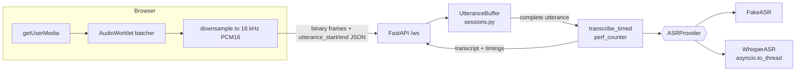

# Architecture

Status key: **Planned** / **Implemented** (code exists) / **Verified** (tests run and passed, or run by hand with the result recorded).

## System as of M1

| Part | Status | Notes |
|---|---|---|
| `GET /health` | Verified | `tests/test_app.py::test_health` |
| `GET /` serves `frontend/index.html` | Verified | `tests/test_frontend.py`; page used by hand |
| `WS /ws` session id, JSON echo, error replies | Verified | M0 tests |
| Real uvicorn server run by hand | Verified | needed `websockets` installed (added to `requirements.txt`); TestClient could not catch this |
| PCM16 validation (`audio.py`) | Verified | `tests/test_audio.py` |
| `ASRProvider` interface, `FakeASR`, provider selection | Verified | `tests/test_audio.py`, `tests/test_whisper.py` |
| Utterance protocol + per-chunk size cap + timing | Verified | `tests/test_asr_ws.py` |
| Browser mic capture + 16 kHz resample (fake provider) | Verified (by hand) | user-reported working; `audio_ms` matched the time recorded |
| `WhisperASR` (faster-whisper `tiny.en`, int8, CPU) | Verified | unit tests with a stub model; real model run by hand, transcript correct |
| Whisper latency numbers | Partial | one cold call and one later call recorded (see `learning-notes.md`); distribution **pending** |
| Streaming ASR | Not planned for M1 | ASR waits for the complete utterance; audio is streamed *in*, text is not streamed *out* |
| Tail of audio (< ~43 ms) dropped at stop | Known limitation | worklet buffer is not flushed on stop |
| `.env` auto-loading | Planned | env vars must be exported in the shell for now |
| `LLMProvider` interface, `FakeLLM`, `prompts.py` (M2 piece 1) | Verified | `tests/test_llm.py`; the fake labels itself and its summary as fake |
| `InterviewSession` state machine (M2 piece 1) | Verified | `tests/test_state.py`; pure, not yet wired to `/ws` |
| `GeminiLLM` streaming (M2 piece 2) | Verified | mocked-HTTP tests (`tests/test_gemini.py`) plus one real call by hand: `gemini-2.5-flash` accepted, reply arrived in 2 pieces |
| WS wiring: start/pause/resume/end, `coach_delta`, TTFT + total timing, summary (M2 piece 3) | Verified (fake LLM only) | `tests/test_llm_ws.py`; pause/end during a turn wait until the turn finishes (inline await), M4 adds cancellation; a client disconnect mid-stream is not handled specially yet |
| Recording allowed in `idle` (M1 transcribe-only) and `listening` | Implemented | keeps M1 behaviour; rejected while paused/thinking/ended |
| Frontend controls + transcript (M2 piece 4) | Verified (by hand, fake providers) | user-reported: start, opening question, one spoken answer, follow-up, end, summary all worked with the FAKE banner. Pause/resume in the browser **not reported**. `tests/test_frontend.py` only checks control ids |
| Real Gemini latency (M2) | Partial | one sample: ttft 3129 ms, total 3283 ms (standalone script, opener prompt, user's machine and network). Distribution **pending** (M5). Not yet run through `/ws` in the browser, and pause/resume in the browser not reported |
| TTS + latency budget (M3) | Planned | |
| Reliability (M4) | Planned | ASR runs while the session is not reading its socket; revisit for cancellation |
| Logs / metrics / load test (M5) | Planned | |
| Docker / CI (M6) | Planned | CI must install `requirements-asr.txt` for `tests/test_whisper.py` (needs numpy) |

## WebSocket message protocol

Server -> client on connect: `{"type":"session","session_id":"<hex>"}`

Client -> server:
- `{"type":"utterance_start","sample_rate":16000}` (only 16000 accepted)
- binary frames: raw PCM16 little-endian mono
- `{"type":"utterance_end"}`
- `{"type":"start","topic","difficulty"}` (difficulty: easy/medium/hard), `{"type":"pause"}`, `{"type":"resume"}`, `{"type":"end"}`
- any other JSON object: echoed (M0 behavior)

Server -> client:
- `{"type":"transcript","session_id","text","provider","audio_ms","asr_ms","rtf"}`; `provider` is `fake` or `faster-whisper`
- `{"type":"state","session_id","state"}`: idle / listening / thinking / paused / ended
- `{"type":"coach_delta","session_id","text"}` (streamed pieces), then `{"type":"coach_done","session_id","text","provider","llm_ttft_ms","llm_total_ms"}`; on failure an `error` follows and the client must discard unfinished deltas
- `{"type":"summary","session_id","text","provider","llm_ttft_ms","llm_total_ms"}`: sent once complete, not streamed; `provider` is `none` when no answers were recorded
- `{"type":"echo","session_id","data","server_ts"}`
- `{"type":"error","session_id","reason"}`; the connection stays open

Error reasons: `invalid JSON`, `JSON must be an object`, `audio received before utterance_start`, `utterance_end without utterance_start`, `no audio received`, `PCM16 data must have an even number of bytes`, `sample_rate must be 16000`, `utterance already in progress; ...`, `utterance longer than 60s` (sent once, further frames dropped until `utterance_end`), `transcription failed`, `coach reply failed`, `summary failed`, `LLM unavailable: ...` (connection then closes), `cannot <event> while <state>`, `empty answer`, `no speech recognized, please try again`, topic/difficulty validation messages.
