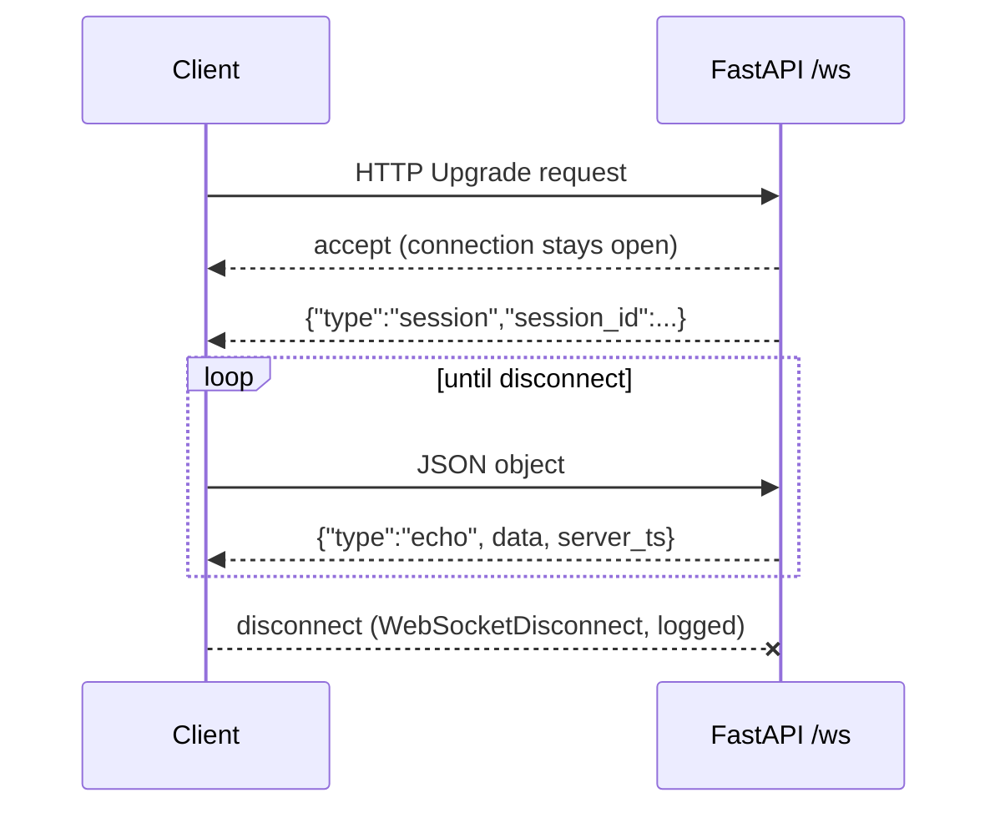

# Learning notes

(Append only. One section per module.)

## M0: Skeleton (FastAPI, /health, WebSocket echo)

- HTTP = one request, one response. WebSocket = one long-lived two-way connection, started by an HTTP upgrade.
- `await` pauses only this handler; the event loop serves other sessions meanwhile.
- `sessions.py` holds pure functions (no FastAPI), so logic is testable without a server. `main.py` stays thin.
- Bad input (invalid JSON, non-object) gets an error message, not a dropped connection. The only exception caught around the loop is `WebSocketDisconnect`.

### Design decisions
| Decision | Choice | Alternatives | Trade-off |
|---|---|---|---|
| Session id | `uuid4().hex` | counter, ULID | unguessable and no shared state; not sortable by time |
| Timestamp | server UTC ISO 8601 | epoch float | readable, unambiguous; slightly bigger payload |
| Bad JSON | error message, keep open | close connection | friendlier to clients; must ensure errors can't loop forever (client controls rate) |
| Parsing | `receive_text` + `json.loads` | `receive_json` | lets us catch bad JSON ourselves instead of the socket erroring |

**Key concept:** the event loop. Async handlers cooperate by yielding at `await`; one blocking call stalls every session.

**Interview question:** Why WebSocket and not HTTP polling for a voice app?
*Short answer:* audio and replies flow both ways continuously; WebSocket avoids per-message connection/headers overhead and lets the server push without being asked, which cuts latency.

**Exercise:** add a `message_count` field to each echo (per session). Where must that counter live, and why not a module global?

**Common mistake:** calling a blocking function (`time.sleep`, a sync HTTP client) inside an `async def` handler, which freezes all sessions. Use `await asyncio.sleep` or run blocking work in a thread.

**Observed:** Starlette's TestClient emits a deprecation warning about `httpx` (suggesting `httpx2`). Harmless in M0; revisit if it turns into an error.
