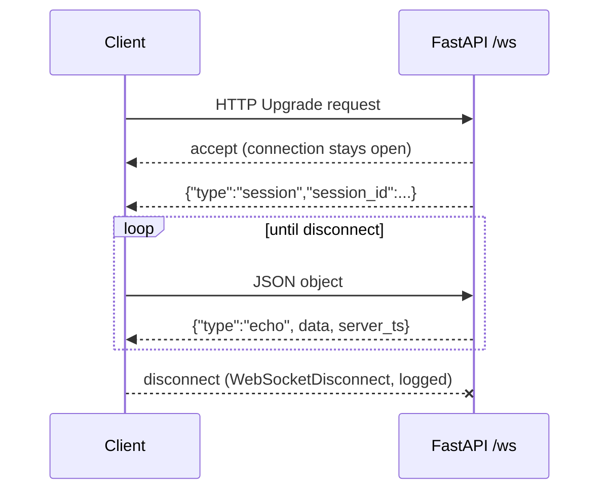
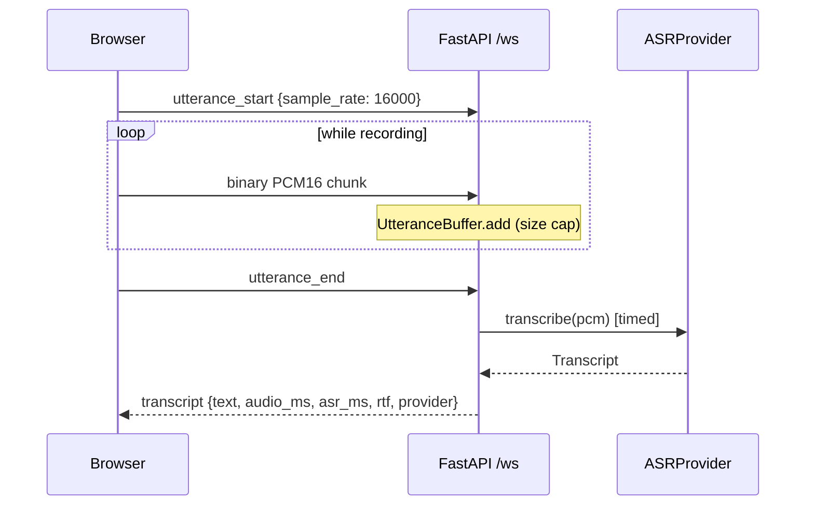
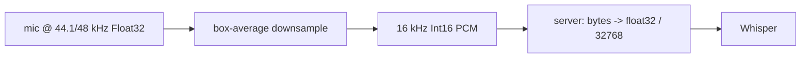

# Learning notes

(Append only. One section per module.)

## M0: Skeleton (FastAPI, /health, WebSocket echo)

- HTTP = one request, one response. WebSocket = one long-lived two-way connection, started by an HTTP upgrade.
- `await` pauses only this handler; the event loop serves other sessions meanwhile.
- `sessions.py` holds pure functions (no FastAPI), so logic is testable without a server. `main.py` stays thin.
- Bad input (invalid JSON, non-object) gets an error message, not a dropped connection. The only exception caught around the loop is `WebSocketDisconnect`.

### Design decisions
| Decision | Choice | Alternatives | Trade-off |
|---|---|---|---|
| Session id | `uuid4().hex` | counter, ULID | unguessable and no shared state; not sortable by time |
| Timestamp | server UTC ISO 8601 | epoch float | readable, unambiguous; slightly bigger payload |
| Bad JSON | error message, keep open | close connection | friendlier to clients; must ensure errors can't loop forever (client controls rate) |
| Parsing | `receive_text` + `json.loads` | `receive_json` | lets us catch bad JSON ourselves instead of the socket erroring |

**Key concept:** the event loop. Async handlers cooperate by yielding at `await`; one blocking call stalls every session.

**Interview question:** Why WebSocket and not HTTP polling for a voice app?
*Short answer:* audio and replies flow both ways continuously; WebSocket avoids per-message connection/headers overhead and lets the server push without being asked, which cuts latency.

**Exercise:** add a `message_count` field to each echo (per session). Where must that counter live, and why not a module global?

**Common mistake:** calling a blocking function (`time.sleep`, a sync HTTP client) inside an `async def` handler, which freezes all sessions. Use `await asyncio.sleep` or run blocking work in a thread.

**Observed:** Starlette's TestClient emits a deprecation warning about `httpx` (suggesting `httpx2`). Harmless in M0; revisit if it turns into an error.

## M1: Mic audio -> WebSocket -> speech recognition (timed)

- Audio is **streamed in** (chunks as you speak) but ASR is **not streaming**: it needs the whole utterance, so the latency that matters is stop-press -> transcript.
- `UtteranceBuffer` (pure, in `sessions.py`) owns the state machine: idle -> collecting -> finished. `main.py` just routes frames to it.
- Providers sit behind a `Protocol`, so the fake and Whisper are interchangeable and the UI always shows which one answered.
- Blocking CPU work (`model.transcribe`) goes through `asyncio.to_thread`, so one transcription does not freeze other sessions.
- faster-whisper returns a **lazy generator**: decoding happens while iterating, so the iteration must happen inside the thread.
- Timing uses `time.perf_counter()` around the provider call only. `rtf = asr_ms / audio_ms` (below 1 = faster than real time).

### Design decisions
| Decision | Choice | Alternatives | Trade-off |
|---|---|---|---|
| Audio format | raw PCM16 mono 16 kHz | MediaRecorder webm/opus | no ffmpeg, matches Whisper's input; ~32 KB/s instead of a few KB/s |
| Resampling | main-thread box average in JS | `AudioContext({sampleRate:16000})`, server-side | works in browsers that reject a fixed context rate; crude low-pass filter, fine for speech |
| ASR engine | local faster-whisper `tiny.en`, int8, CPU | browser Web Speech API, Gemini audio | audio stays on the machine, free, testable and timeable server-side; costs CPU and a model download. Web Speech is Chrome-centric and sends audio to a cloud |
| Provider interface | `typing.Protocol` | abstract base class | no inheritance needed; less enforcement at runtime |
| Memory cap | check on every chunk, 60 s | check only at `utterance_end` | a client cannot fill memory by never ending; after overflow, frames are dropped silently so errors do not flood |
| Error handling | `AudioError` / `ASRError` caught narrowly | catch `Exception` | real bugs still surface in logs; each expected failure has a clear client message |
| Dependency scope | `requirements-asr.txt` optional | everything in one file | demo mode and light CI stay fast; tests for the Whisper wrapper need numpy |

### Measured (user's laptop; hardware not recorded)
| Call | audio_ms | asr_ms | rtf | Notes |
|---|---|---|---|---|
| 1st ever (model download + load inside) | 6656 | 20951 | 3.15 | logged load 10836 ms; decode only ~10115 ms / rtf ~1.52 are **derived by subtraction** |
| later call (call order not recorded) | 7338.6 | 987.6 | 0.135 | browser `stop->text` 991 ms, so localhost network + browser overhead was ~3 ms |

One warm sample is **not** a distribution. Pending: model load time from the disk cache, short and long utterances, many samples (p50/p95 comes in M5), two sessions at once.

**Key concept:** cold start vs steady state. The first call paid for the model download, the load and first-inference setup, and looked about 20x worse than a later call (20951 ms vs 987.6 ms). Always report them separately.

**Interview question:** Your ASR takes about 1 s for 7 s of speech. Does that mean you can serve many users?
*Short answer:* No. rtf is per request on an otherwise idle machine. `to_thread` keeps the event loop responsive, but transcriptions still compete for the same CPU cores, so throughput is bounded by cores and tail latency grows with concurrency. I would measure it with a load test (planned for M5) instead of extrapolating from one number.

**Exercise:** open two browser tabs with `ASR_PROVIDER=whisper`, and press stop in both within a second. Predict `asr_ms` for each, then compare. What does the result say about the limit above?

**Common mistake:** (1) quoting the first request's latency as "the latency", and (2) believing green tests mean the real server works. Here all tests passed while `uvicorn` rejected every WebSocket because no WebSocket library was installed: `TestClient` bypasses uvicorn's network layer.

**Observed:**
- Uvicorn needs `websockets` (or `wsproto`) for `/ws`; added to `requirements.txt`.
- Uvicorn only configures its own loggers, so our `logger.info` lines were hidden until `logging.basicConfig(level=INFO)`. That also exposes noisy `httpx2` / Hugging Face request lines; structured logging comes in M5.
- Hugging Face warns about unauthenticated downloads. Harmless for a public model.
