# Learning notes

(Append only. One section per module.)

## M0: Skeleton (FastAPI, /health, WebSocket echo)

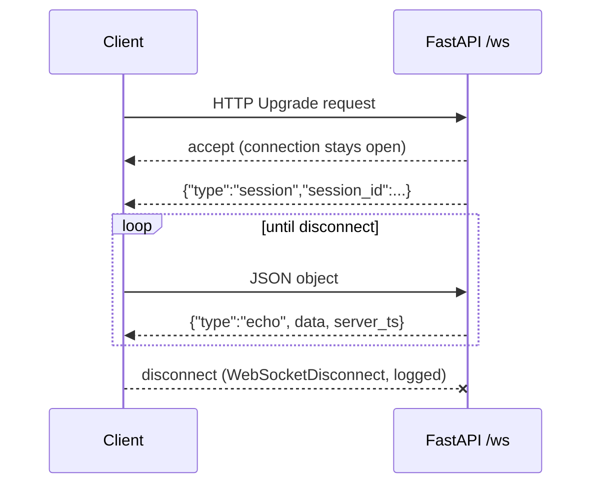

- HTTP = one request, one response. WebSocket = one long-lived two-way connection, started by an HTTP upgrade.
- `await` pauses only this handler; the event loop serves other sessions meanwhile.
- `sessions.py` holds pure functions (no FastAPI), so logic is testable without a server. `main.py` stays thin.
- Bad input (invalid JSON, non-object) gets an error message, not a dropped connection. The only exception caught around the loop is `WebSocketDisconnect`.

### Design decisions
| Decision | Choice | Alternatives | Trade-off |
|---|---|---|---|
| Session id | `uuid4().hex` | counter, ULID | unguessable and no shared state; not sortable by time |
| Timestamp | server UTC ISO 8601 | epoch float | readable, unambiguous; slightly bigger payload |
| Bad JSON | error message, keep open | close connection | friendlier to clients; must ensure errors can't loop forever (client controls rate) |
| Parsing | `receive_text` + `json.loads` | `receive_json` | lets us catch bad JSON ourselves instead of the socket erroring |

**Key concept:** the event loop. Async handlers cooperate by yielding at `await`; one blocking call stalls every session.

**Interview question:** Why WebSocket and not HTTP polling for a voice app?
*Short answer:* audio and replies flow both ways continuously; WebSocket avoids per-message connection/headers overhead and lets the server push without being asked, which cuts latency.

**Exercise:** add a `message_count` field to each echo (per session). Where must that counter live, and why not a module global?

**Common mistake:** calling a blocking function (`time.sleep`, a sync HTTP client) inside an `async def` handler, which freezes all sessions. Use `await asyncio.sleep` or run blocking work in a thread.

**Observed:** Starlette's TestClient emits a deprecation warning about `httpx` (suggesting `httpx2`). Harmless in M0; revisit if it turns into an error.

## M1: Mic audio -> WebSocket -> speech recognition (timed)

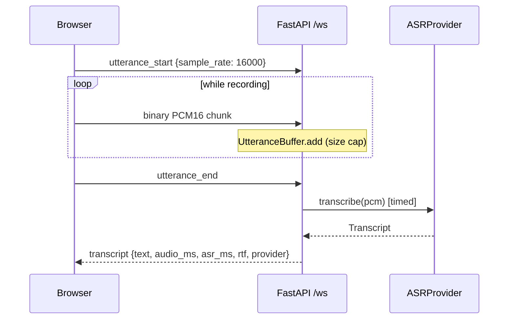

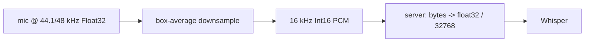

- Audio is **streamed in** (chunks as you speak) but ASR is **not streaming**: it needs the whole utterance, so the latency that matters is stop-press -> transcript.
- `UtteranceBuffer` (pure, in `sessions.py`) owns the state machine: idle -> collecting -> finished. `main.py` just routes frames to it.
- Providers sit behind a `Protocol`, so the fake and Whisper are interchangeable and the UI always shows which one answered.
- Blocking CPU work (`model.transcribe`) goes through `asyncio.to_thread`, so one transcription does not freeze other sessions.
- faster-whisper returns a **lazy generator**: decoding happens while iterating, so the iteration must happen inside the thread.
- Timing uses `time.perf_counter()` around the provider call only. `rtf = asr_ms / audio_ms` (below 1 = faster than real time).

### Design decisions
| Decision | Choice | Alternatives | Trade-off |
|---|---|---|---|
| Audio format | raw PCM16 mono 16 kHz | MediaRecorder webm/opus | no ffmpeg, matches Whisper's input; ~32 KB/s instead of a few KB/s |
| Resampling | main-thread box average in JS | `AudioContext({sampleRate:16000})`, server-side | works in browsers that reject a fixed context rate; crude low-pass filter, fine for speech |
| ASR engine | local faster-whisper `tiny.en`, int8, CPU | browser Web Speech API, Gemini audio | audio stays on the machine, free, testable and timeable server-side; costs CPU and a model download. Web Speech is Chrome-centric and sends audio to a cloud |
| Provider interface | `typing.Protocol` | abstract base class | no inheritance needed; less enforcement at runtime |
| Memory cap | check on every chunk, 60 s | check only at `utterance_end` | a client cannot fill memory by never ending; after overflow, frames are dropped silently so errors do not flood |
| Error handling | `AudioError` / `ASRError` caught narrowly | catch `Exception` | real bugs still surface in logs; each expected failure has a clear client message |
| Dependency scope | `requirements-asr.txt` optional | everything in one file | demo mode and light CI stay fast; tests for the Whisper wrapper need numpy |

### Measured (user's laptop; hardware not recorded)
| Call | audio_ms | asr_ms | rtf | Notes |
|---|---|---|---|---|
| 1st ever (model download + load inside) | 6656 | 20951 | 3.15 | logged load 10836 ms; decode only ~10115 ms / rtf ~1.52 are **derived by subtraction** |
| later call (call order not recorded) | 7338.6 | 987.6 | 0.135 | browser `stop->text` 991 ms, so localhost network + browser overhead was ~3 ms |

One warm sample is **not** a distribution. Pending: model load time from the disk cache, short and long utterances, many samples (p50/p95 comes in M5), two sessions at once.

**Key concept:** cold start vs steady state. The first call paid for the model download, the load and first-inference setup, and looked about 20x worse than a later call (20951 ms vs 987.6 ms). Always report them separately.

**Interview question:** Your ASR takes about 1 s for 7 s of speech. Does that mean you can serve many users?
*Short answer:* No. rtf is per request on an otherwise idle machine. `to_thread` keeps the event loop responsive, but transcriptions still compete for the same CPU cores, so throughput is bounded by cores and tail latency grows with concurrency. I would measure it with a load test (planned for M5) instead of extrapolating from one number.

**Exercise:** open two browser tabs with `ASR_PROVIDER=whisper`, and press stop in both within a second. Predict `asr_ms` for each, then compare. What does the result say about the limit above?

**Common mistake:** (1) quoting the first request's latency as "the latency", and (2) believing green tests mean the real server works. Here all tests passed while `uvicorn` rejected every WebSocket because no WebSocket library was installed: `TestClient` bypasses uvicorn's network layer.

**Observed:**
- Uvicorn needs `websockets` (or `wsproto`) for `/ws`; added to `requirements.txt`.
- Uvicorn only configures its own loggers, so our `logger.info` lines were hidden until `logging.basicConfig(level=INFO)`. That also exposes noisy `httpx2` / Hugging Face request lines; structured logging comes in M5.
- Hugging Face warns about unauthenticated downloads. Harmless for a public model.

## M2: LLM follow-up, history, session state machine (timed)

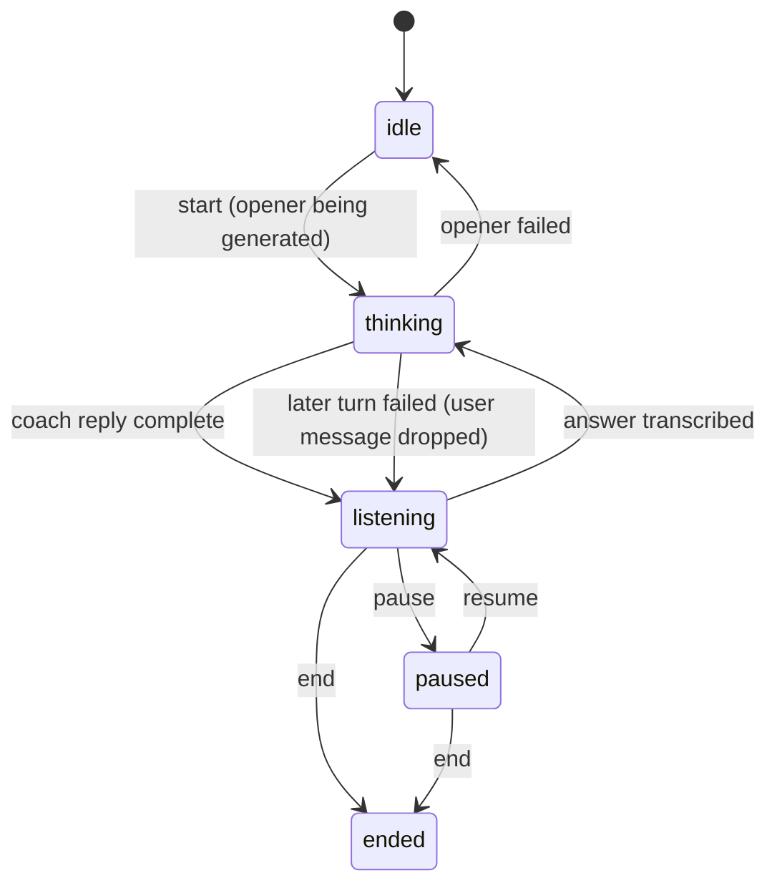

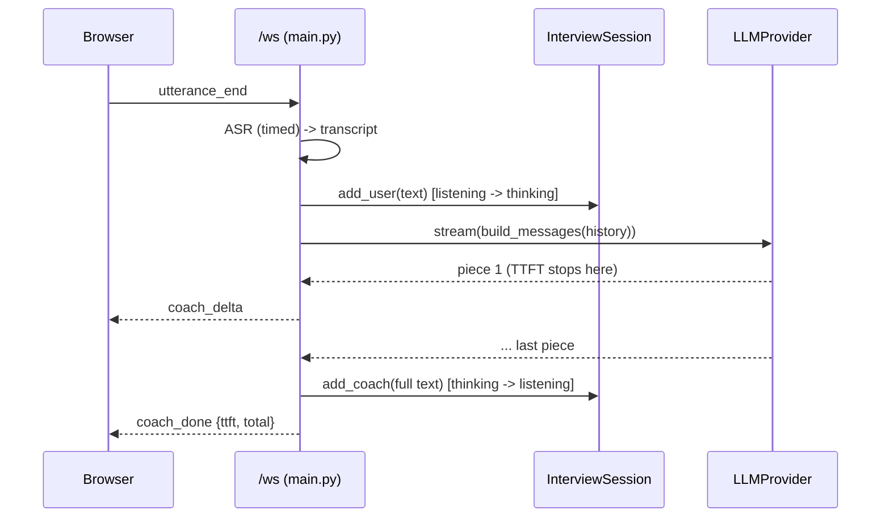

- The session is a **state machine**: every event is checked against the current state in one place (`InterviewSession`), so "answer while paused" cannot corrupt history. It is pure Python, so every transition is a plain unit test.
- The LLM sits behind `LLMProvider` (a `Protocol` with `stream()`), like ASR. `FakeLLM` is deterministic and labels itself; `GeminiLLM` talks plain HTTPS + server-sent events.
- Streaming is real only on the coach reply: pieces are forwarded as they arrive. The summary and ASR wait for a complete result and are not streamed.
- History is written only when a reply is **complete**. A failed turn removes the unanswered user message, so roles always alternate and the prompt stays valid.
- Prompt = system prompt (topic, difficulty) + fixed "begin" message + the last 12 messages, never starting mid-exchange. Bounded prompt, so cost and latency cannot grow forever.
- Two LLM numbers: **TTFT** (time to first piece, what the user feels) and **total** (to the last piece). `llm_total_ms` includes forwarding to the client.

### Design decisions
| Decision | Choice | Alternatives | Trade-off |
|---|---|---|---|
| LLM provider | Gemini free tier (default fake) | local Ollama | no CPU competition with Whisper and fast to set up; transcripts leave the machine, rate limits, needs a key. Ollama is private but heavy on a laptop |
| Gemini client | plain `httpx` + SSE parsing | Google SDK | one fewer dependency and visible timing; we parse events ourselves |
| API key | `x-goog-api-key` header | `?key=` in URL | keys in URLs leak through logs and error messages |
| State machine | pure class, explicit transitions | flags in `main.py` | more code; each illegal event handled once and tested without a server |
| History write | after the full reply only | append each delta | no half replies after failures; the client holds partial text and discards it on `error` |
| Failed turn | drop the unanswered user message | keep it and retry | roles keep alternating, prompt stays valid; the user has to speak again |
| Recording in `idle` | allowed (transcribe only, no LLM) | require `start` first | keeps M1 behaviour and tests; slightly blurs the state machine |
| Missing LLM key | error message, then close | silently fall back to fake | a fake must never pass as real |
| Prompt limit | last 12 messages | whole history | loses early context; bounded latency |
| HTTP client | new `AsyncClient` per turn | one shared client | simple; pays a TLS handshake each turn, to be measured in M5 |

### Verified so far
- 74 tests pass (state machine, prompts, fake LLM, Gemini against a **mocked** HTTP transport, WebSocket flow with fake and failing LLMs).
- By hand, fake providers only: full flow in the browser worked (start, answer, follow-up, end, summary).
- **Pending:** a real Gemini call (model name `gemini-2.5-flash` unconfirmed), real TTFT/total numbers, pause/resume in the browser.

**Key concept:** time to first token vs total time. With streaming, a user starts reading or hearing the answer after TTFT, not after the full reply. This matters most in M3, when text-to-speech can begin on the first sentence.

**Interview question:** Why use a state machine for the session instead of a few booleans?
*Short answer:* Booleans allow impossible combinations (paused and thinking at once) and spread the checks across handlers. A state machine lists the legal transitions in one place, rejects everything else with a clear error, and can be unit tested without any network.

**Exercise:** the user presses Pause while the coach is still streaming. In the current code, what happens, and why? Then sketch how M4 would change it (hint: the handler is blocked inside `await coach_turn`, so it is not reading the socket).

**Common mistake:** saving partial output to history as it streams. If the stream dies halfway, the next prompt contains a cut-off coach message, or two user messages in a row, and the model's behaviour becomes hard to explain. Write history once, when the turn succeeds.

### M2 addendum: first real Gemini measurement

| Call | Model | ttft_ms | total_ms | Pieces | Notes |
|---|---|---|---|---|---|
| opener, standalone script (`GeminiLLM.stream` directly) | gemini-2.5-flash | 3129 | 3283 | 2 | one sample, not a distribution; includes a fresh TLS connection; hardware and network not recorded |

- Almost all the time (3129 of 3283 ms) passed **before the first piece**. After that, the rest arrived within about 150 ms.
- So for short replies, streaming barely helps: the wait is TTFT, not the transfer. It would matter for long replies, or when M3 starts speaking the first sentence early.
- **Hypotheses, not yet tested** (each needs its own measurement):
  - the model "thinks" before answering (Gemini 2.5 models have a thinking phase by default);
  - the new connection per turn adds a handshake;
  - the first call after idle is slower than later ones.
- The reply also ran longer than the prompt's "max 2 sentences" ("Alright, let's get started." plus the question). The prompt is a request, not a guarantee; the app does not enforce length.

## M3: Text-to-speech + full pipeline + latency budget

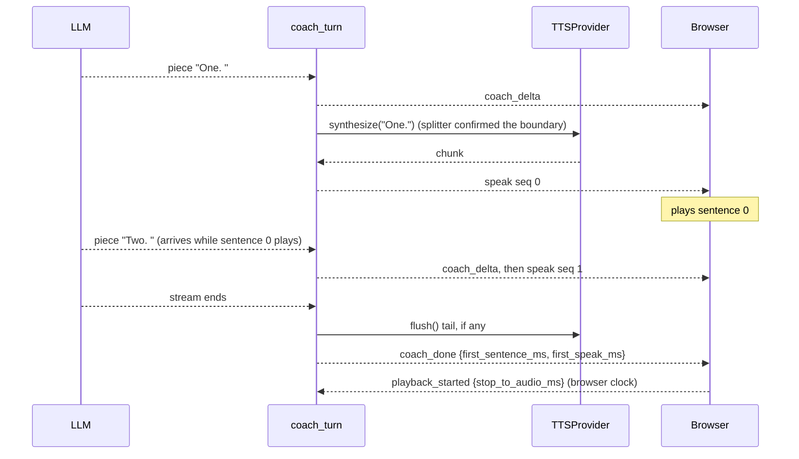

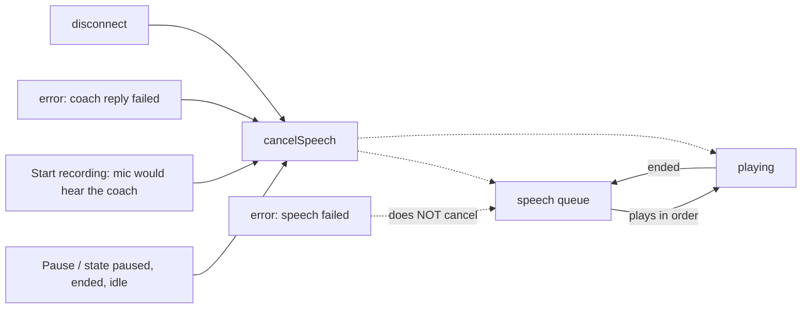

- The reply is cut into sentences as it streams. Sentence 1 is spoken while the LLM writes sentence 2, so **time to first sound** depends on the first sentence, not the whole reply.
- Honest streaming claim: LLM -> splitter -> TTS dispatch is per piece and per sentence. Each TTS call waits for a complete sentence (not token-level TTS), and ASR still waits for the full utterance.
- `SentenceSplitter` is pure: a boundary needs `.?!`, an optional closing quote, then whitespace. A trailing `.` at the end of the buffer waits for the next piece (it could be `3.` then `5`), so a sentence is released one piece late, or at `flush()`.
- `SpokenChunk.audio` is bytes or `None`. `None` means "the browser speaks `text`", so one shape serves the browser now and a server engine (Piper) later.
- The server cannot hear playback. For browser speech it reports `tts_ms: null`, and the browser reports when sound actually started (`playback_started`). The two clocks are never mixed.
- A TTS failure is isolated: one `speech failed` error, the text keeps streaming, history is written as usual. An LLM failure mid-reply discards text **and** queued speech on the client.
- TTS runs inline in the stream loop, so a slow server-side TTS delays reading the next LLM piece and `llm_total_ms` includes it. Fixing it (queue + worker) needs cancellation, which is M4.

### Design decisions
| Decision | Choice | Alternatives | Trade-off |
|---|---|---|---|
| Real TTS engine | browser `speechSynthesis` (`TTS_PROVIDER=browser`) | local Piper | zero install and starts fast; voices differ per browser and OS, some Chrome voices use a cloud, and the server cannot time it. Piper is local and server-timeable but needs a binary + voice and competes with Whisper for CPU |
| Fake TTS | labelled 440 Hz beep as a WAV | silence, or a canned recording | deterministic, testable, audible in a demo; clearly not speech, and the UI says FAKE |
| Speech unit | one complete sentence | token or word level | simple and natural prosody; first sound waits for the first full sentence |
| Audio transport | base64 inside JSON | binary WebSocket frames | one message type, easy to test; about 33% larger. Fine for short sentences |
| Queue location | client, in order by `seq` | server paces playback | the browser knows when audio ends; the server cannot |
| Cancel rules | explicit list (pause, end, idle, record, reply failed, disconnect) | cancel on any error | `speech failed` must not cut the sentences already playing |
| First-audio timing | browser `performance.now()` | server estimate | that is where the user hears it; costs an extra client -> server message |
| TTS in the stream loop | inline await | queue + worker task | simple and testable now; couples TTS speed to LLM reading until M4 |
| Warnings | one per stage (asr / llm / tts) | one global line | a fake stage is never hidden by a real one |

### Verified so far
- 107 tests pass (`.venv/bin/python -m pytest -q`): 9 splitter, 9 TTS, 14 WS (`tests/test_tts_ws.py`), 1 frontend wiring, plus the earlier 74.
- By hand, user-reported, one session per provider: fake beep heard, real browser voice heard, opener spoken without an extra click, voice stopped mid-sentence by Pause and by Start recording, pause + resume worked.
- Browser used: VS Code's built-in browser; user guessed it is Chromium but did not confirm. Real Chrome, Safari and Firefox: **not tested**.
- **Pending:** the real pipeline (Whisper + Gemini + voice) end to end, a distribution of any number (M5), two sessions at once, long replies, a slow server TTS in the browser.

### Measured (one sample per column; ASR and LLM were fakes)
| Stage | Fake voice | Browser voice |
|---|---|---|
| first sentence complete (server, from turn start) | 1 ms | 0.8 ms |
| first `speak` sent (server) | 18.3 ms | 0.9 ms |
| llm_total (server) | 18.3 ms | 0.9 ms |
| stop press -> first sound (browser clock) | 52 ms | 69 ms |

These are an overhead floor with fake upstream stages, not the pipeline latency. The 18.3 vs 0.9 ms gap fits "inline fake TTS cost is inside `llm_total_ms`", but it compares two runs and is not an isolated measurement. Full table: `docs/architecture.md`.

**Key concept:** pipelining. Overlapping stages (generate sentence 2 while sentence 1 plays) cuts time to first sound, not total work. Measure it where the user feels it, and be exact about the granularity: here it is per sentence.

**Interview question:** Is your voice pipeline streaming end to end?
*Short answer:* Partly, and I can say exactly where. Audio streams in, but ASR waits for the whole utterance. The LLM streams pieces, a splitter cuts them into sentences, and each complete sentence goes to TTS right away, so sentence 1 plays while sentence 2 is generated. Each TTS call still waits for one full sentence, and TTS runs inline, so a slow server TTS would delay reading the LLM. I measure server stages with `perf_counter` and first sound in the browser, never mixing the clocks.

**Exercise:** in `tests/test_tts_ws.py`, give `FakeTTS(delay_s=0.2)` to a 3-sentence `ScriptedLLM`. Predict `first_speak_ms` and `llm_total_ms` first, then run it and compare. What would a queue + worker task change, and what new failure case would it create on pause?

**Common mistake:** subtracting a browser timestamp from a server one (or adding them). The clocks are unrelated, so the result is meaningless. Report each on its own clock, and say where each was measured.

**Observed:**
- This project has no async pytest plugin, so async tests are wrapped in `asyncio.run`, as in `tests/test_llm.py`. My first TTS test file used `async def` tests and failed with "async def functions are not natively supported" until I switched pattern.
- Chrome can garbage-collect a `SpeechSynthesisUtterance` before `onend` fires, so the page keeps a global reference.
- `speechSynthesis.cancel()` fires `onend` / `onerror` for the cancelled item; a generation counter stops those late callbacks from advancing a cleared queue.

## M4: Reliability (deadlines, cancellation, safe retry, cleanup)

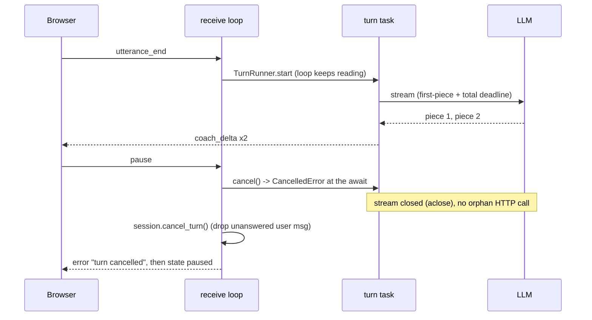

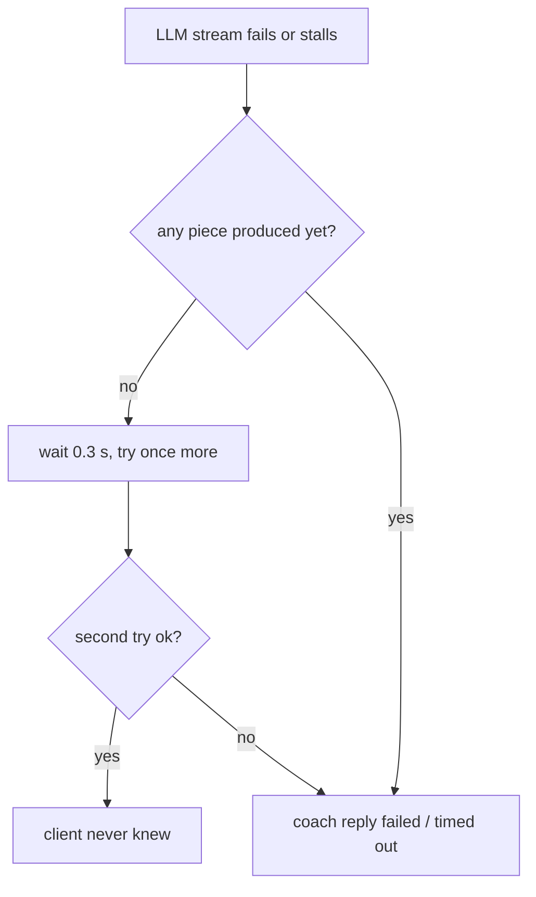

- **Why it was needed:** the receive loop awaited the whole turn, so while Whisper or Gemini worked, the server could not read Pause, End, or the disconnect. A stuck provider froze the session.
- **Fix:** the turn runs as a separate task (`TurnRunner`, one per session). The loop only reads and dispatches. Pause/End/disconnect call `task.cancel()`; `CancelledError` unwinds through `finally` blocks, so streams are closed.
- **Deadlines:** `asyncio.timeout` wrapped in `with_deadline`, raising our own `StageTimeout(stage)`. It checks `expired()` so a `TimeoutError` from inside the awaited code is not mislabelled as our deadline.
- **Retry rule:** repeat only what is safe to repeat. Before the first piece, nothing has reached the client and no history was written, so one retry is invisible. After the first piece a retry would send the first words twice, so we fail instead. The rule is in `stream_with_retry`, not inside Gemini, so fakes and real providers share it.
- **Rollback guard:** `interrupt()` calls `cancel_turn()` only when the state is `thinking`. A reply that just finished is `listening` and keeps its text. A cancel during ASR is also `listening`: nothing was added yet.
- **SafeSender:** one lock for all sends, and a closed socket returns `False` instead of raising, so a turn racing a disconnect ends quietly.
- **One broad `except Exception`:** only at the task boundary (`guarded`). Nobody awaits the task, so an unexpected exception would vanish; it is logged with its traceback and the client gets `internal error`. `CancelledError` is a `BaseException` and passes through.

### Design decisions
| Decision | Choice | Alternatives | Trade-off |
|---|---|---|---|
| Long work | background task per turn, loop keeps reading | keep inline, add a "cancel" flag polled between awaits | tasks cancel at any `await`, flags only where we remembered to look; cost: more concurrency to reason about (sends, state races) |
| Where retry lives | `stream_with_retry` in `reliability.py` | inside `GeminiLLM` | one policy, testable with fakes; cannot see error type, so a permanent error (bad key) is retried too (0.3 s wasted) |
| Retry limit | once, before the first piece | exponential backoff, several tries | bounded added latency (about 0.3 s plus a second attempt); gives up on longer outages |
| Pause during a turn | cancel + rollback, then pause | wait for the turn to finish (M2/M3) | user is in control at once; the interrupted answer is lost and must be repeated |
| `cancel_turn` | separate pure method, `main.py` orchestrates | let `pause()` / `end()` accept `thinking` | rollback is one tested method; `pause()` / `end()` stay strict |
| Second request while busy | `busy` error | queue it | simple, no hidden queue; the client must wait |
| Timeout values | env-overridable guesses | hard-coded | tests use 0.05 s; real values wait for M5 data |
| Reply to a cancelled turn | reuse the "any error discards partial text and queued speech" rule | new message type | no frontend protocol change; the reason text carries the meaning |
| Frontend | Pause/End enabled while thinking | unchanged | without this the server capability was unreachable from the UI (found by reading `refresh()`) |

### Verified so far
- 148 tests pass (`.venv/bin/python -m pytest -q`, run in this session): 20 in `test_reliability.py`, 14 in `test_cancel_ws.py`, 7 new state cases, plus the earlier suite.
- **Pending:** a real `uvicorn` run (close the tab mid-reply, Pause during a slow reply in the browser), real Gemini/Whisper through the new task path, and any measured timeout values.
- **Not done:** fallback providers (second LLM, server TTS -> browser), killing a Whisper thread, limits across sessions (M5).

**Key concept:** cancellation is cooperative. `task.cancel()` raises `CancelledError` at the task's next `await`; `finally` and `async with` then clean up. Code that never awaits (a blocking call, a worker thread) cannot be cancelled: that is why a Whisper timeout abandons the result but the thread keeps running.

**Interview question:** How do you decide what is safe to retry in a streaming pipeline?
*Short answer:* Retry only when repeating cannot be observed: no output has left the server and no state was written. Here that means a failure before the first LLM piece. After the first piece the client has already shown text, so a retry would duplicate it; I fail cleanly and roll the history back instead. Retries are bounded (once) and live in one place so they are testable.

**Exercise:** `Timeouts.llm_total_s` covers LLM reading plus the inline TTS and sends. Set `TIMEOUT_TTS_S=4`, `TIMEOUT_LLM_TOTAL_S=5` and give `FakeTTS(delay_s=3)` a 3-sentence reply. Predict which deadline fires and what the client sees (hint: the deadlines nest, and TTS failures do not retry).

**Common mistake:** adding a retry or a timeout and not checking old tests that rely on single failures. Two M2 tests injected one failure and waited for the error; with the retry the failure vanished and they hung in `receive_json` (the suite has no per-test timeout). Run with `-o faulthandler_timeout=15` to see which test is stuck.

**Observed:**
- I first named a fake counter `calls`; two test subclasses already used `calls` as a list, and 8 tests broke with a confusing `TypeError`. Grep for an attribute name before adding it to a class that tests subclass.
- `asyncio.wait({task})` is the way to wait for a cancelled task without swallowing our own cancellation; `await task` inside `except CancelledError` would.
- TestClient runs the app in a separate thread with its own event loop, so a test that never receives an expected message blocks forever instead of failing.

### M4 addendum: first real-server run
By hand, user-reported, one session, fake providers, `FAKE_LLM_DELAY_S=1`:
- Pause during a streaming reply: the beep stopped and an `error: turn cancelled` line appeared.
- Resume, then a new answer: a normal reply.
- Closing the tab mid-reply: the server logged `disconnected`.
- **Not reported:** whether the partial coach line was removed, whether the status showed `paused`, and whether the server log contained a traceback or `client gone`. Browser not recorded. The "Pending" items under "Verified so far" above that are not listed here (real Gemini/Whisper, measured timeouts) are still pending.
- What this adds over `TestClient`: the real uvicorn network layer accepted the cancel and the disconnect, which is what hid a bug in M1.

## M5: Observability (metrics, JSON logs, dashboard, load test)

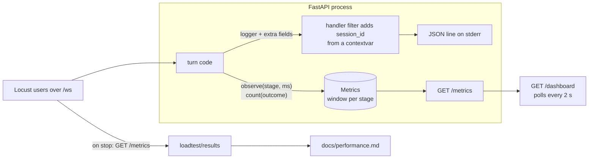

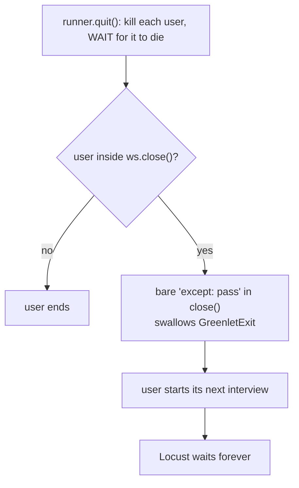

- A sample is a duration in ms from `perf_counter`. `Metrics` keeps the newest N per stage and sorts them only when `/metrics` is read. Percentile = nearest rank, so it is always a value that really happened.
- `error_rate = (failed + timeout) / (ok + failed + timeout)`. A user's Pause is not an error, and a failed turn records no latency sample.
- The session id lives in a `ContextVar`, set once per connection. Tasks copy the context when created, so code that knows nothing about sessions (the retry in `reliability.py`) still logs with the right id.
- Every load-test step used a fresh server, because counters and the window are cumulative. The window had to be raised (`METRICS_WINDOW`): at 100 users the default 1000 samples covered only the last seconds of a step.
- Measure first, explain second. Three results here looked wrong and were not what they seemed: a hang, "latency falls as users rise", and a 200-user step that was the load generator's limit.

### Design decisions
| Decision | Choice | Alternatives | Trade-off |
|---|---|---|---|
| Metrics store | hand-written, newest-N window, exact percentiles | `prometheus_client` histograms | explains p50/p95 exactly, no dependency; only a window, not scrapeable by Prometheus |
| Session id in logs | contextvar + handler filter | `extra=` at every call | one place to set it, reaches every module; needs knowing how tasks copy context |
| Log shape | fixed keys + a nested `fields` object | free-form extra keys | `fields` cannot overwrite `ts`/`level`/`msg`; one level of nesting |
| Dashboard | table + stat tiles, polling `fetch` | charts, WebSocket push | exact values on very different scales, accessible, simple; no history or trend |
| Load tool | Locust + `websocket-client` | k6 | same language; needs a WebSocket client and care with gevent (see below) |
| Closing a load-test socket | `ws.shutdown()` | `ws.close()` | server sees an abrupt disconnect (same path as a closed tab); no handshake that can swallow a kill |
| Server window for load tests | `METRICS_WINDOW` env, default 1000 | reset endpoint, per-step snapshots | one variable, `window` is reported in every snapshot; sorting a huge window costs more per scrape |
| Load shape | closed loop, fresh server per step, 3 repeats, steps interleaved | open loop, one long run | simple and repeatable, spread is visible; latency at high users is capped by the user count |

### Verified so far
- 186 tests pass (`.venv/bin/python -m pytest -q`, run in this session): 18 metrics, 8 metrics-over-WebSocket, 8 logs, 4 dashboard, plus the earlier 148.
- Real uvicorn run: the same `session_id` on every app log line. Dashboard: dark mode and the "cannot read /metrics" banner seen by hand.
- Load tests (fake providers 1-100 users, real Whisper 1-32 users): numbers and caveats in `docs/performance.md`.
- **Pending:** real Gemini under load (not planned), the whole real pipeline, other browsers, open-loop load, memory use, and the cause of the Whisper plateau (a guess only).

**Key concept:** saturation. As load grows, throughput rises until a resource is full, then stops, and every extra user only adds waiting time. Real Whisper plateaued at about 4 answers per second; asr p50 went 242 ms (1 user) -> 674 ms (8) -> 2868 ms (16) -> 7167 ms (32) with no errors. One user's latency says nothing about the limit.

**Interview question:** Your ASR takes 242 ms for a 7.9 s clip. How many users can you serve?
*Short answer:* One user's latency is not capacity. I load-tested it: throughput stopped growing at about 4 answers per second (around 8 users), and past that latency grew with the number of users (asr p50 7.2 s at 32), with no failures because the 30 s deadline was never reached. The event loop stayed free (the other stages did not slow down), so the limit is the Whisper stage itself. My guess, not yet tested, is that it runs one transcription at a time; I would change that setting and rerun before claiming anything.

**Exercise:** raise the number of Whisper workers (or `cpu_threads`) in `WhisperASR` and rerun 8 and 16 users. Predict first: where should the plateau move, and what would tell you the CPU itself, not the setting, is the limit?

**Common mistake:** trusting a library call you did not read. `websocket-client`'s `close()` ends in `except: pass`, which also swallows cancellation (`GreenletExit`, like `CancelledError` in asyncio). A user killed inside `close()` kept running and Locust waited forever. Cancellation only works if nothing in the path catches it; read the `except` clauses of code that runs during cleanup.

**Observed:**
- Latency fell as users rose (1 user 15 ms server, 100 users 4.7 ms) in all 3 repeats. With two busy loops on other cores, the 1-user step also dropped to 5.0 ms. So the machine, not the app, explains it; the mechanism was not measured.
- Locust printed `CPU usage above 90%` at 200 users. That step measured the load generator as much as the server, so it is not a capacity figure.
- zsh treats a bare `======` word as a command; use a different separator in shell snippets.

## M6: Docker, CI, and a README that only states what was run

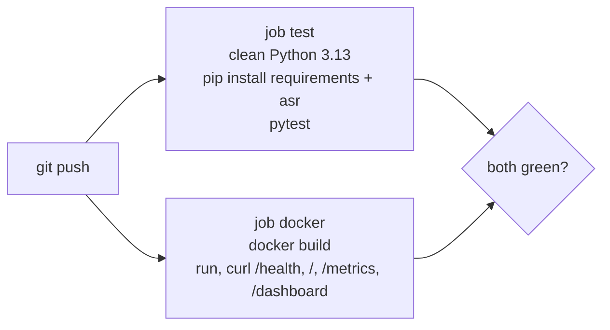

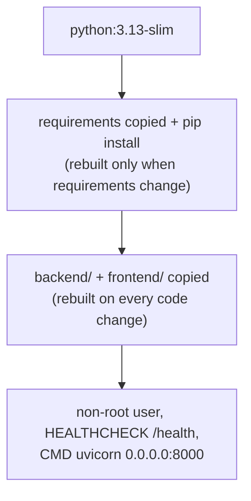

- A clean environment is the only honest test of "does it work for someone else". Mine has every package installed, so it cannot show a missing dependency.
- Demo mode must start without the optional Whisper packages. That works because `faster_whisper` is imported lazily, inside `WhisperASR._get_model`. A clean virtual environment with only `requirements.txt` confirmed it.
- Layer order is a speed decision: dependencies change rarely, code changes constantly, so dependencies are installed first and cached.
- The container listens on `0.0.0.0` (it has to), so the port is published on `127.0.0.1` only. `/metrics` has no authentication.
- Secrets are never baked into the image: keys are passed with `-e` at run time.

### Design decisions
| Decision | Choice | Alternatives | Trade-off |
|---|---|---|---|
| Base image | `python:3.13-slim` | alpine, full Debian image | matches the Python used locally; slim has glibc wheels for faster-whisper; bigger than alpine |
| Whisper in the image | opt-in `--build-arg WITH_ASR=1` | always installed | the default image is small and needs no downloads; the Whisper image is large and downloads the model on first use |
| Runtime user | non-root `appuser` | root (default) | a bug in the app cannot write across the container; the home directory must be writable for a model cache |
| CI jobs | tests and Docker build in separate jobs | one job | independent failures, run in parallel; the image is built twice if you also build locally |
| CI test deps | `requirements-asr.txt` too | install numpy alone | one declared place for optional deps; the install is slower |
| Load test in CI | not included | nightly job | needs minutes and a generator that does not share the machine under test; a noisy shared runner would make numbers meaningless |
| README numbers | only measured ones, with setup and a "not measured" list | round marketing figures | longer, but every figure can be traced to `docs/performance.md` |

### Verified so far
- Local, by running: a clean virtual environment with only `requirements.txt` serves all four pages and finishes a fake-provider opener over WebSocket; the same environment plus `requirements-asr.txt` passes the suite (186 passed).
- The workflow YAML parses.
- **Update 2026-11-03: the first GitHub Actions run was green (user-reported; per-job details not recorded).** (The Docker image had been built and run locally in demo mode first; see `docs/architecture.md`.)

**Key concept:** reproducibility. A build or test result only counts if it can be repeated from a declared recipe on a machine that has nothing else. Dockerfile and CI are the recipe, written down.

**Interview question:** How do you know your CI is testing the same thing you run locally?
*Short answer:* I do not assume it. The CI job installs from the same requirements files into a clean environment, so anything my laptop has that the files do not declare shows up as a failure there. I ran the same steps in a clean virtual environment before relying on it. What I cannot claim is that the GitHub run itself is green until it has actually run.

**Exercise:** break the recipe on purpose. Remove `numpy` from the CI install (drop `requirements-asr.txt`), run the suite in a clean virtual environment, and read which tests fail and why. Then decide whether to install numpy alone or keep the file.

**Common mistake:** treating a file that parses as a pipeline that works. The workflow YAML is valid and the Dockerfile reads well, but neither has run: the first real run will find the problems (a wrong action version, a missing package in the slim image).

**Observed:**
- In zsh, `path` is tied to `$PATH`. A shell loop `for path in ...` replaced the search path, so `curl`, `head` and `lsof` suddenly "did not exist", and a line like `lsof ... || echo "port free"` then printed "free" for the wrong reason. Use another variable name, and distrust a success message that only comes from `||`.
- The Docker CLI can be installed while the daemon is not running; `docker --version` succeeding proves nothing about being able to build.

### Addendum: first real runs by hand (2026-11-02)

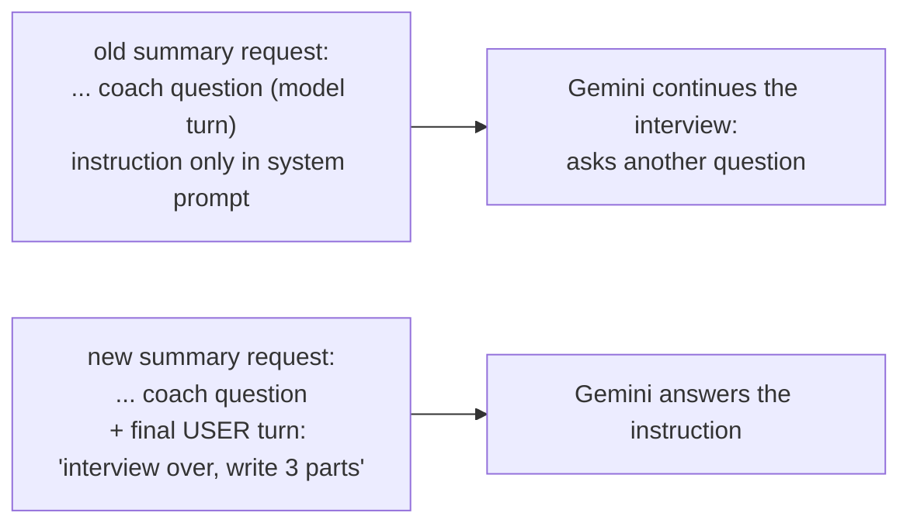

- **A prompt bug that no test could see.** The fake LLM ignores message order, so 186 tests passed while real Gemini answered the summary request as the coach (first it failed, then it returned a question). The fix is structural: the instruction is a final user turn, and a test now checks that every prompt ends with a user turn and that roles alternate.
- **A fake used by mistake.** One "whole pipeline" run had the fake ASR on, and the coach rightly said it got no answer. The UI label and the `connected` log line (`asr`, `llm`, `tts`) are how to tell; check them before trusting a run.
- **Common mistake (extra):** fixing a fake-friendly code path and calling the feature done. Anything the fake cannot imitate (message order, empty replies, rate limits) needs its own test or a real run.
- Real-LLM timings and what is still pending are in `docs/architecture.md` (rows dated 2026-11-02).
- The summary prompt now also receives the topic and difficulty (judge answers against the level) and ends with a one-line **Practice next**. Measured stats (speaking time, words per answer, filler words) were left for the delivery-feedback stretch goal: speaking time is not stored per answer yet, and Whisper may drop "um/uh", so filler counts could read too low (not measured). Key-point coverage waits for the question bank.

## Question bank: the bank asks, the LLM follows up (2026-11-03)

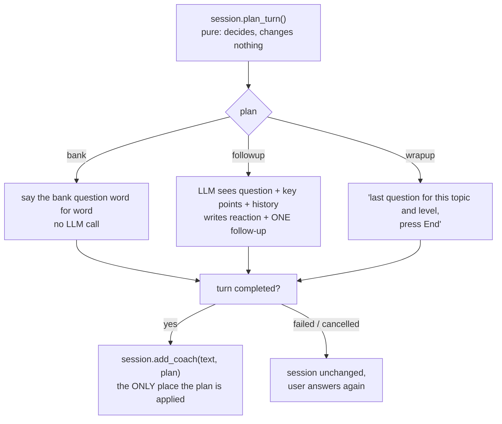

- **Problem:** the LLM invented the questions, so they were unreliable and could not be defended, and the first turn spent one of 20 free Gemini requests per day.
- **Now:** questions come from `backend/question_bank.json` (topic, difficulty, key points). A bank question is spoken as written, with no LLM call. The LLM only writes follow-ups (2 per question) and the end summary. It gets the question and its key points in the system prompt, so it can probe what was missed.
- **Where the key points live:** in the system prompt, not the history, because the history window keeps only the last 12 messages and the original question would be trimmed out of a long conversation.

### Design decisions
| Decision | Choice | Alternatives | Trade-off |
|---|---|---|---|
| Who writes the main questions | curated JSON bank | LLM invents them | I can defend every question; costs me writing and reviewing the content, and the bank is finite |
| Follow-ups per question | 2, env `FOLLOWUPS_PER_QUESTION` (0-5) | 1, or LLM decides | closer to a real interview; fewer topics per session. A setting, so it can change without code |
| When session state changes | plan first, commit in `add_coach` | mutate while planning | a failed or cancelled turn needs no undo code. The existing rollback only pops the user message, so mutating early would leave a question marked asked that was never said |
| Bank loading | once at startup, fail fast | read per request | a bad file stops the server immediately, not mid-interview |
| Topics | must come from the bank, dropdown from `GET /topics` | free text | the UI can only offer topics that have questions; the old free-text topics are gone |
| Bank turn timing | `null`, no metric sample | record 0 ms | a 0 would pull the LLM percentiles down and be an invented number |
| Provider label for a bank line | `"bank"`, ignored by the FAKE banner logic | reuse `"fake"` / `"none"` | a bank line says nothing about whether the LLM is real; treating it as "not fake" would hide the FAKE warning |

### Verified so far
- 236 tests pass (run 2026-11-03). One real uvicorn server run in demo mode: turns went bank, fake follow-up, fake follow-up, bank, fake follow-up, then the summary.
- **Pending:** a run with real Gemini (does it avoid reading the key points out, stay on the question, ask exactly one follow-up?) and the dropdown seen in a browser.

**Key concept:** separate deciding from doing. `plan_turn` is a pure function of the session; `add_coach` is the single commit point. Pure planning is easy to unit test, and cancellation safety comes from the structure instead of extra cleanup code.

**Interview question:** Why does your coach speak the bank question itself instead of asking the LLM to ask it?
*Short answer:* The questions are curated, so the LLM must not reword or replace them. Speaking the stored text keeps them defensible and testable, makes that turn free and instant (no LLM call, no quota), and leaves the LLM the part it is good at: reacting to what the candidate actually said.

**Exercise:** set `FOLLOWUPS_PER_QUESTION=0` and run a demo-mode session. Predict the sequence of coach turns before you run it, then check the `plan` field in the logs.

**Common mistake:** changing session state while deciding what to do next. When the turn then fails, the state says a question was asked that the candidate never heard, and the retry skips it.

**Observed while building:**
- Changing the opener broke about 25 tests, and several of them *hung* instead of failing: they waited for an error that could no longer happen because the opener no longer calls the LLM. A test that waits forever is worse than one that fails. Run suspect test files with a time limit (`perl -e 'alarm 30; exec @ARGV' ...`) to find the hanging one.
- The FAKE-LLM warning in the page is driven by the provider name of each message. A new name (`bank`) would have cleared the warning by accident, so a test now pins that a bank line does not count as "the LLM is real".

## Code-owned interview loop: the LLM decides one thing, the code decides the rest (2026-11-03)

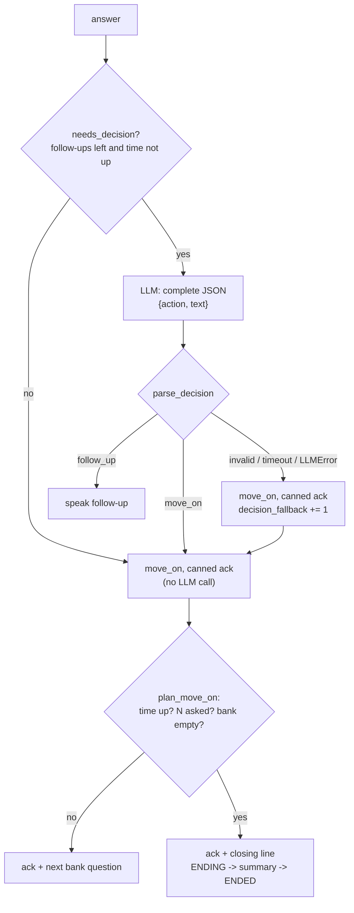

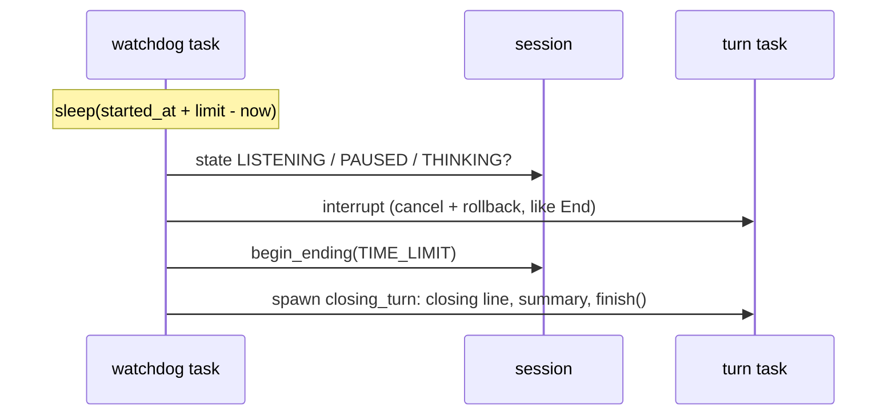

- **Problem:** the old loop asked a fixed 2 follow-ups whatever the answer, and the interview never ended by itself: the candidate had to press End.
- **Now:** after each answer the LLM returns `{"action": "follow_up" | "move_on", "text": ...}`. The **code** enforces the cap (the model is not even asked once 2 follow-ups were used), picks the next bank question, and ends the interview after N questions (5/6/8/10, default 6), at the time limit (15 min), when the bank runs out, or on End. All of these go through a new `ENDING` state: closing line, summary with `end_reason`, then `ENDED`.
- **Untrusted output:** `parse_decision` treats the reply like a form submitted by a stranger: JSON object, known action, non-empty text of at most 400 chars, no key point copied word for word. Anything else becomes `move_on` with "Thanks for that answer.", so a bad reply can never stall or derail a session.
- **Time without sleeping:** the session takes `now` as an argument (a monotonic reading). Each end condition is a one-line unit test with a made-up clock. Only one WebSocket test waits in real time (0.2 s), and that is for the watchdog itself.

### Design decisions
| Decision | Choice | Alternatives | Trade-off |
|---|---|---|---|
| Who owns the loop | code; the LLM only picks follow_up / move_on | the LLM decides everything ("ask the next question when ready") | limits, order and endings are testable and cannot be talked out of; the model has less freedom to adapt the flow |
| Streaming vs validation | wait for the complete JSON, validate, then speak | stream the `text` field with an incremental JSON parser | simple and honest; **follow-ups are no longer streamed**, so first sound now waits for the whole LLM reply (real cost: pending a Gemini run) |
| Getting JSON | prompt + parser, Gemini unchanged | Gemini JSON mode (`responseMimeType`) | provider-agnostic (Ollama or the fake work the same); the model can still break format, so the fallback carries the load |
| On a bad decision | move_on with a canned ack | retry the LLM; show an error and roll back | the candidate never sees an error and the session always progresses; one question may get fewer follow-ups than it deserved. No extra retry keeps free-tier quota |
| Fallback and the error rate | fallback turn = `turn_ok`, plus a separate `decision_fallback` counter | count it as `turn_failed` | the turn did succeed for the user; but now `error_rate` alone would look healthy during a Gemini outage, so the dashboard shows the fallback tile next to it |
| Time limit | wall time from Start, pauses included, hard (a running turn is cancelled) | pause the clock; finish the current turn first | simplest rule to state and test; a long pause uses up interview time |
| Ending | separate `ENDING` state | jump straight to `ENDED` and summarise | the closing line and summary run where pause, record and start are all illegal, so nothing can interleave with them |
| Question count menu | 5, 6, 8, 10 (6 default) | only 5/8/10 as first asked | a default that is not on the menu could not be chosen again in the UI |

### Verified so far
- 279 tests pass (`.venv/bin/python -m pytest -q`, run 2026-11-03, 3.80 s).
- One real uvicorn run in demo mode with `INTERVIEW_TIME_LIMIT_S=2`: one answer, then the watchdog fired at 2.00 s and the messages came in the right order (`ending`, closing line, summary with `end_reason: time_limit`, `ended`).
- **Pending:** real Gemini (does it return valid JSON, how often does it fall back, does it still avoid the key points?), the real latency cost of not streaming follow-ups, and the page seen in a browser.

**Key concept:** LLM output is untrusted input. Validate it against a schema before it drives control flow, and give every failure a deterministic, safe default. The model then suggests and the code decides.

**Interview question:** Your LLM is told "ask at most 2 follow-ups". Why do you also enforce that in code?
*Short answer:* A prompt is a request, not a guarantee: the model can ignore it, and the next prompt change can break it. The cap is a business rule, so it belongs in code where a unit test pins it. The code does not even call the model once the cap is reached, which also saves quota and latency.

**Exercise:** turn on Gemini JSON mode (`generationConfig.responseMimeType = "application/json"`) for decision requests only. Run a few real sessions and compare how often `decision_fallback` rises with and without it. Keep the parser either way.

**Common mistake:** catching the LLM failure in the same `except` that also catches cancellation. Pause and End must still cancel and roll back the turn; only provider problems become `move_on`. `CancelledError` is a `BaseException`, so `except (LLMError, StageTimeout)` lets it through, and a broad `except Exception` would not be the fix either.

**Observed while building:**
- Several WebSocket tests waited for streamed deltas that no longer exist, so they hung instead of failing. The fix was a `threading.Event` the fake LLM sets at its stall point (TestClient runs the app in another thread), not a sleep.
- "Thanks for that answer. Let's move on." read badly before "That was the last question", so the canned acknowledgement became just "Thanks for that answer.", which fits before both.
- Awaiting the cancelled watchdog under `suppress(CancelledError)` could also swallow a cancellation of the WebSocket handler itself, so it is cancelled and not awaited.

### Addendum: first real Gemini run of the loop (2026-11-03)

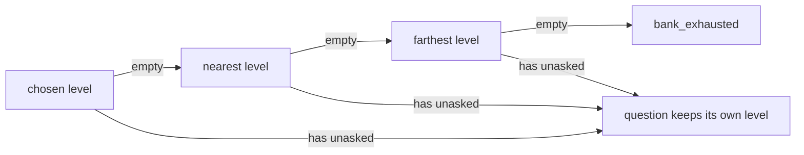

- **Found:** a 5-question interview ended after 2 questions. Every topic and level has only 2-6 questions, so `bank_exhausted` came first almost everywhere. The WebSocket tests had passed because they used tiny made-up banks, and none of them asked whether the *real* bank could fill a real interview. A test now checks that every topic has at least the default 6.
- **Fix:** the chosen level is a preference, not a filter. When it runs out, the nearest level on the same topic is used. The decision prompt and summary prompt get each question's own level, so a borrowed easy question is not judged as hard.
- **Measured:** time to first token 2183 ms and total 2197 ms at the median of 3 decision calls. Waiting for the complete JSON cost about 14 ms here, because the reply is short. One fallback, caused by an invalid reply; the reason is still to be read from the log.

| Decision | Choice | Alternatives | Trade-off |
|---|---|---|---|
| Thin bank | borrow the nearest level, same topic | write about 210 questions; cap the menu by what exists; accept early ends | no new content and the interview fills up; the level is no longer pure, so the prompts must judge each question at its own level |

**Common mistake:** testing only with small hand-made data. The logic was right for the test bank and wrong for the real one. Add one test that runs your rules over the shipped data.

## Delivery feedback: numbers the code measures, not opinions the model writes (2026-11-03)

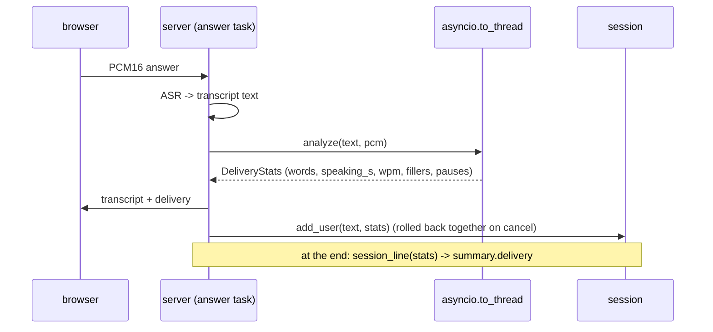

- **Problem:** the coach judged *what* you said but not *how*: rate, hesitation, long silences, rambling.
- **Now:** every answer gets measured numbers. The summary ends with one sentence built by code from those numbers, for example "3 answers, 24 s on average; 132 words per minute; 2 filler words ...; 1 pause of 1 s or more (longest 1.8 s)."
- **Silence detection, in one line:** cut the audio into 30 ms frames, compute each frame's loudness (RMS), and call a frame silent when it is quieter than 10% of the clip's loud level (but always below 200). Pauses are runs of silent frames of at least 1 s *between* speech; leading and trailing silence is trimmed.

### Design decisions
| Decision | Choice | Alternatives | Trade-off |
|---|---|---|---|
| Source of pauses | the audio (frame loudness) | Whisper word timestamps | works with any ASR and the fake, no extra Whisper cost, unit-testable with synthetic audio; cannot tell a breath from a thinking pause, and room noise can hide a pause |
| Who states the numbers | code (`session_line`) | give the numbers to the LLM | no invented or misquoted number, no extra quota; the wording is plain and fixed |
| Silence threshold | relative (10% of the 90th-percentile loudness) with a fixed floor | one fixed loudness | copes with quiet and loud microphones; one very loud cough can raise the threshold for that clip |
| Fillers | conservative list (um, uh, er, hmm, ah, you know, I mean) | include like / so / actually | fewer false positives ("I like lists"); an undercount, made worse by Whisper dropping fillers |
| Where it runs | `asyncio.to_thread` | inline in the event loop | 28 ms for 60 s of audio, so inline would mostly be fine; the thread makes sure one long answer never delays other sessions |
| Storage | one stats entry per user message, popped on rollback | a separate list appended only when stats exist | the two lists cannot drift apart: an entry can be `None`, but it always exists |

### Verified so far
- 307 tests pass (run 2026-11-03).
- The detector on the `say` test clip: word gaps 30-210 ms, no pauses, 7.74 s of speaking in a 7.89 s clip.
- **Pending:** a real microphone in a normal room, and the page seen in a browser.

**Key concept:** keep the LLM away from facts the code can measure. Measured numbers come from code, and the model only interprets the parts that need language. The same idea as the code-owned loop.

**Interview question:** How do you detect pauses without a speech model?
*Short answer:* Energy-based voice activity detection. Split the audio into short frames, compute each frame's RMS loudness, mark frames below a threshold as silence, and measure runs of silent frames between the first and last speech frame. The threshold is relative to the clip's own loud level so different microphones work. Its limits are that it can't tell speech from other loud noise and that it needs tuning; WebRTC VAD or Silero are the usual next steps.

**Exercise:** record yourself answering once fluently and once with deliberate long pauses. Compare `pauses` and `longest_pause_s` in the transcript message, then try `RELATIVE_SILENCE` at 0.05 and 0.2 and see which one matches what you heard.

**Common mistake:** keeping per-answer data in a list that is appended "only when there is data", next to a history that is rolled back by popping. The first rollback without data pops the wrong entry, and the summary then counts an answer that was cancelled.

### Addendum: first Docker build and run (2026-11-03)

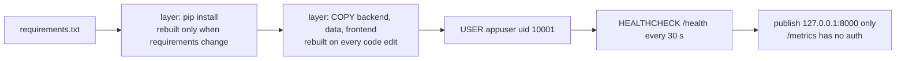

- **Measured, once:** build 25 s (first build on this laptop), image 251 MB, `healthy` within 8 s of starting, one demo interview through the container with 0 error log lines. One run, not a benchmark.
- **Why the checks are not just `docker run`:** the container being up says little. `/health` answers from inside the app, `docker inspect` shows the HEALTHCHECK itself works, `id` shows it is not root, and `ls /app` shows no `.env` was copied in.
- **Found nothing wrong,** which is a result too: `COPY data ./data` (added when the bank moved) was the only Dockerfile change needed, and the build confirmed it.

**Interview question:** Why copy `requirements.txt` before the source code in a Dockerfile?
*Short answer:* Docker caches each layer. The dependency install only reruns when a requirements file changes. Copying the source first would invalidate that layer on every code edit, and every rebuild would reinstall everything.

**Common mistake:** publishing the container port on all interfaces (`-p 8000:8000`). This app's `/metrics` has no authentication, so the README publishes it on `127.0.0.1` only.
