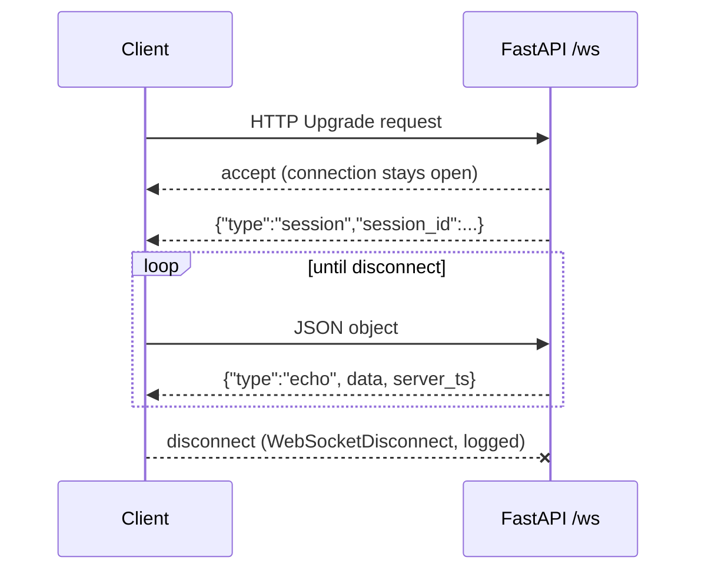
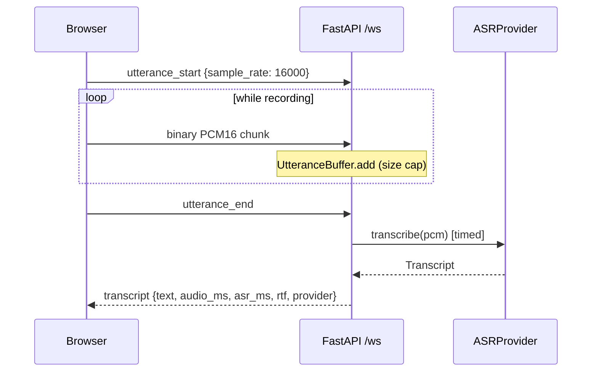
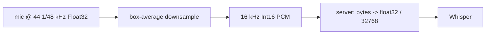
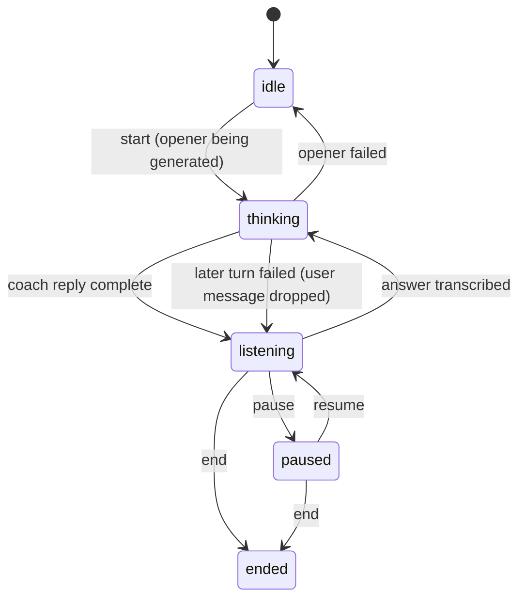
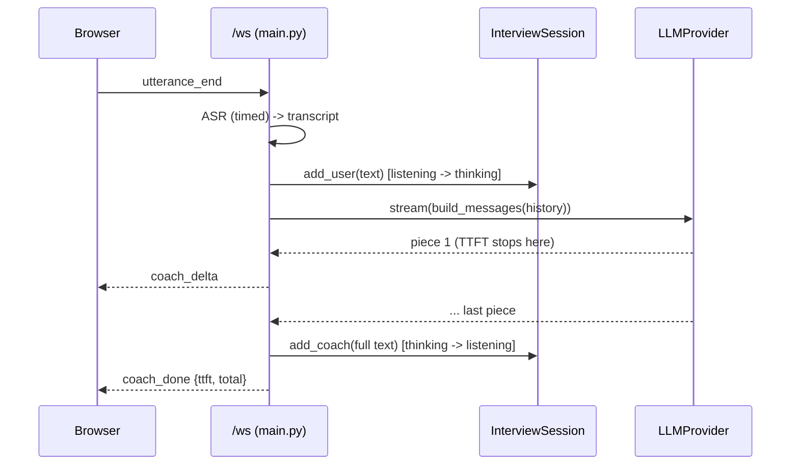
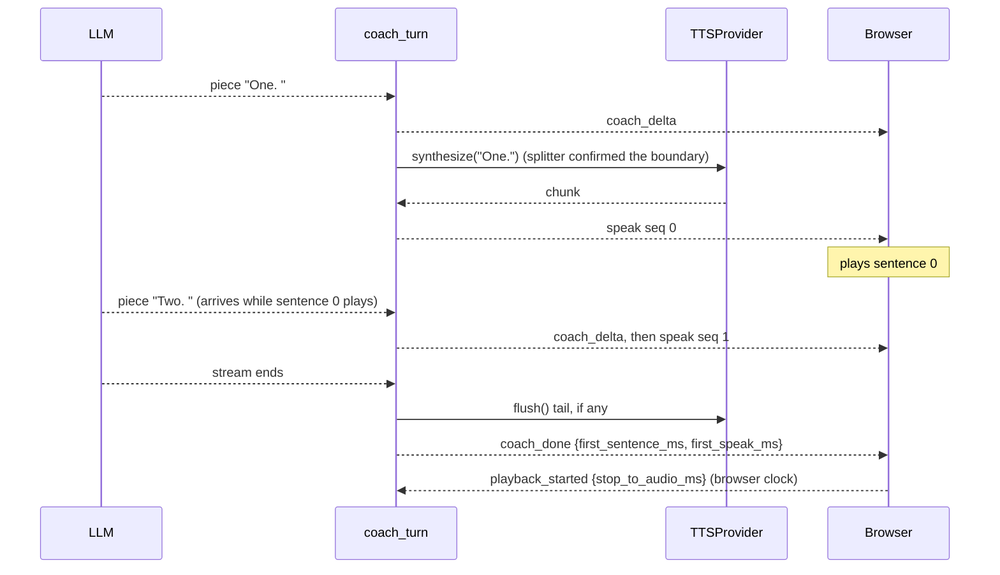
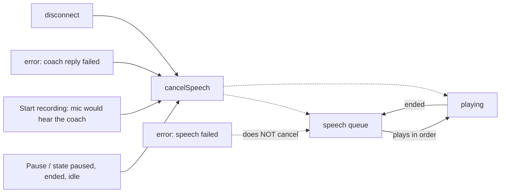

# Learning notes

(Append only. One section per module.)

## M0: Skeleton (FastAPI, /health, WebSocket echo)

- HTTP = one request, one response. WebSocket = one long-lived two-way connection, started by an HTTP upgrade.
- `await` pauses only this handler; the event loop serves other sessions meanwhile.
- `sessions.py` holds pure functions (no FastAPI), so logic is testable without a server. `main.py` stays thin.
- Bad input (invalid JSON, non-object) gets an error message, not a dropped connection. The only exception caught around the loop is `WebSocketDisconnect`.

### Design decisions
| Decision | Choice | Alternatives | Trade-off |
|---|---|---|---|
| Session id | `uuid4().hex` | counter, ULID | unguessable and no shared state; not sortable by time |
| Timestamp | server UTC ISO 8601 | epoch float | readable, unambiguous; slightly bigger payload |
| Bad JSON | error message, keep open | close connection | friendlier to clients; must ensure errors can't loop forever (client controls rate) |
| Parsing | `receive_text` + `json.loads` | `receive_json` | lets us catch bad JSON ourselves instead of the socket erroring |

**Key concept:** the event loop. Async handlers cooperate by yielding at `await`; one blocking call stalls every session.

**Interview question:** Why WebSocket and not HTTP polling for a voice app?
*Short answer:* audio and replies flow both ways continuously; WebSocket avoids per-message connection/headers overhead and lets the server push without being asked, which cuts latency.

**Exercise:** add a `message_count` field to each echo (per session). Where must that counter live, and why not a module global?

**Common mistake:** calling a blocking function (`time.sleep`, a sync HTTP client) inside an `async def` handler, which freezes all sessions. Use `await asyncio.sleep` or run blocking work in a thread.

**Observed:** Starlette's TestClient emits a deprecation warning about `httpx` (suggesting `httpx2`). Harmless in M0; revisit if it turns into an error.

## M1: Mic audio -> WebSocket -> speech recognition (timed)

- Audio is **streamed in** (chunks as you speak) but ASR is **not streaming**: it needs the whole utterance, so the latency that matters is stop-press -> transcript.
- `UtteranceBuffer` (pure, in `sessions.py`) owns the state machine: idle -> collecting -> finished. `main.py` just routes frames to it.
- Providers sit behind a `Protocol`, so the fake and Whisper are interchangeable and the UI always shows which one answered.
- Blocking CPU work (`model.transcribe`) goes through `asyncio.to_thread`, so one transcription does not freeze other sessions.
- faster-whisper returns a **lazy generator**: decoding happens while iterating, so the iteration must happen inside the thread.
- Timing uses `time.perf_counter()` around the provider call only. `rtf = asr_ms / audio_ms` (below 1 = faster than real time).

### Design decisions
| Decision | Choice | Alternatives | Trade-off |
|---|---|---|---|
| Audio format | raw PCM16 mono 16 kHz | MediaRecorder webm/opus | no ffmpeg, matches Whisper's input; ~32 KB/s instead of a few KB/s |
| Resampling | main-thread box average in JS | `AudioContext({sampleRate:16000})`, server-side | works in browsers that reject a fixed context rate; crude low-pass filter, fine for speech |
| ASR engine | local faster-whisper `tiny.en`, int8, CPU | browser Web Speech API, Gemini audio | audio stays on the machine, free, testable and timeable server-side; costs CPU and a model download. Web Speech is Chrome-centric and sends audio to a cloud |
| Provider interface | `typing.Protocol` | abstract base class | no inheritance needed; less enforcement at runtime |
| Memory cap | check on every chunk, 60 s | check only at `utterance_end` | a client cannot fill memory by never ending; after overflow, frames are dropped silently so errors do not flood |
| Error handling | `AudioError` / `ASRError` caught narrowly | catch `Exception` | real bugs still surface in logs; each expected failure has a clear client message |
| Dependency scope | `requirements-asr.txt` optional | everything in one file | demo mode and light CI stay fast; tests for the Whisper wrapper need numpy |

### Measured (user's laptop; hardware not recorded)
| Call | audio_ms | asr_ms | rtf | Notes |
|---|---|---|---|---|
| 1st ever (model download + load inside) | 6656 | 20951 | 3.15 | logged load 10836 ms; decode only ~10115 ms / rtf ~1.52 are **derived by subtraction** |
| later call (call order not recorded) | 7338.6 | 987.6 | 0.135 | browser `stop->text` 991 ms, so localhost network + browser overhead was ~3 ms |

One warm sample is **not** a distribution. Pending: model load time from the disk cache, short and long utterances, many samples (p50/p95 comes in M5), two sessions at once.

**Key concept:** cold start vs steady state. The first call paid for the model download, the load and first-inference setup, and looked about 20x worse than a later call (20951 ms vs 987.6 ms). Always report them separately.

**Interview question:** Your ASR takes about 1 s for 7 s of speech. Does that mean you can serve many users?
*Short answer:* No. rtf is per request on an otherwise idle machine. `to_thread` keeps the event loop responsive, but transcriptions still compete for the same CPU cores, so throughput is bounded by cores and tail latency grows with concurrency. I would measure it with a load test (planned for M5) instead of extrapolating from one number.

**Exercise:** open two browser tabs with `ASR_PROVIDER=whisper`, and press stop in both within a second. Predict `asr_ms` for each, then compare. What does the result say about the limit above?

**Common mistake:** (1) quoting the first request's latency as "the latency", and (2) believing green tests mean the real server works. Here all tests passed while `uvicorn` rejected every WebSocket because no WebSocket library was installed: `TestClient` bypasses uvicorn's network layer.

**Observed:**
- Uvicorn needs `websockets` (or `wsproto`) for `/ws`; added to `requirements.txt`.
- Uvicorn only configures its own loggers, so our `logger.info` lines were hidden until `logging.basicConfig(level=INFO)`. That also exposes noisy `httpx2` / Hugging Face request lines; structured logging comes in M5.
- Hugging Face warns about unauthenticated downloads. Harmless for a public model.

## M2: LLM follow-up, history, session state machine (timed)

- The session is a **state machine**: every event is checked against the current state in one place (`InterviewSession`), so "answer while paused" cannot corrupt history. It is pure Python, so every transition is a plain unit test.
- The LLM sits behind `LLMProvider` (a `Protocol` with `stream()`), like ASR. `FakeLLM` is deterministic and labels itself; `GeminiLLM` talks plain HTTPS + server-sent events.
- Streaming is real only on the coach reply: pieces are forwarded as they arrive. The summary and ASR wait for a complete result and are not streamed.
- History is written only when a reply is **complete**. A failed turn removes the unanswered user message, so roles always alternate and the prompt stays valid.
- Prompt = system prompt (topic, difficulty) + fixed "begin" message + the last 12 messages, never starting mid-exchange. Bounded prompt, so cost and latency cannot grow forever.
- Two LLM numbers: **TTFT** (time to first piece, what the user feels) and **total** (to the last piece). `llm_total_ms` includes forwarding to the client.

### Design decisions
| Decision | Choice | Alternatives | Trade-off |
|---|---|---|---|
| LLM provider | Gemini free tier (default fake) | local Ollama | no CPU competition with Whisper and fast to set up; transcripts leave the machine, rate limits, needs a key. Ollama is private but heavy on a laptop |
| Gemini client | plain `httpx` + SSE parsing | Google SDK | one fewer dependency and visible timing; we parse events ourselves |
| API key | `x-goog-api-key` header | `?key=` in URL | keys in URLs leak through logs and error messages |
| State machine | pure class, explicit transitions | flags in `main.py` | more code; each illegal event handled once and tested without a server |
| History write | after the full reply only | append each delta | no half replies after failures; the client holds partial text and discards it on `error` |
| Failed turn | drop the unanswered user message | keep it and retry | roles keep alternating, prompt stays valid; the user has to speak again |
| Recording in `idle` | allowed (transcribe only, no LLM) | require `start` first | keeps M1 behaviour and tests; slightly blurs the state machine |
| Missing LLM key | error message, then close | silently fall back to fake | a fake must never pass as real |
| Prompt limit | last 12 messages | whole history | loses early context; bounded latency |
| HTTP client | new `AsyncClient` per turn | one shared client | simple; pays a TLS handshake each turn, to be measured in M5 |

### Verified so far
- 74 tests pass (state machine, prompts, fake LLM, Gemini against a **mocked** HTTP transport, WebSocket flow with fake and failing LLMs).
- By hand, fake providers only: full flow in the browser worked (start, answer, follow-up, end, summary).
- **Pending:** a real Gemini call (model name `gemini-2.5-flash` unconfirmed), real TTFT/total numbers, pause/resume in the browser.

**Key concept:** time to first token vs total time. With streaming, a user starts reading or hearing the answer after TTFT, not after the full reply. This matters most in M3, when text-to-speech can begin on the first sentence.

**Interview question:** Why use a state machine for the session instead of a few booleans?
*Short answer:* Booleans allow impossible combinations (paused and thinking at once) and spread the checks across handlers. A state machine lists the legal transitions in one place, rejects everything else with a clear error, and can be unit tested without any network.

**Exercise:** the user presses Pause while the coach is still streaming. In the current code, what happens, and why? Then sketch how M4 would change it (hint: the handler is blocked inside `await coach_turn`, so it is not reading the socket).

**Common mistake:** saving partial output to history as it streams. If the stream dies halfway, the next prompt contains a cut-off coach message, or two user messages in a row, and the model's behaviour becomes hard to explain. Write history once, when the turn succeeds.

### M2 addendum: first real Gemini measurement

| Call | Model | ttft_ms | total_ms | Pieces | Notes |
|---|---|---|---|---|---|
| opener, standalone script (`GeminiLLM.stream` directly) | gemini-2.5-flash | 3129 | 3283 | 2 | one sample, not a distribution; includes a fresh TLS connection; hardware and network not recorded |

- Almost all the time (3129 of 3283 ms) passed **before the first piece**. After that, the rest arrived within about 150 ms.
- So for short replies, streaming barely helps: the wait is TTFT, not the transfer. It would matter for long replies, or when M3 starts speaking the first sentence early.
- **Hypotheses, not yet tested** (each needs its own measurement):
  - the model "thinks" before answering (Gemini 2.5 models have a thinking phase by default);
  - the new connection per turn adds a handshake;
  - the first call after idle is slower than later ones.
- The reply also ran longer than the prompt's "max 2 sentences" ("Alright, let's get started." plus the question). The prompt is a request, not a guarantee; the app does not enforce length.

## M3: Text-to-speech + full pipeline + latency budget

- The reply is cut into sentences as it streams. Sentence 1 is spoken while the LLM writes sentence 2, so **time to first sound** depends on the first sentence, not the whole reply.
- Honest streaming claim: LLM -> splitter -> TTS dispatch is per piece and per sentence. Each TTS call waits for a complete sentence (not token-level TTS), and ASR still waits for the full utterance.
- `SentenceSplitter` is pure: a boundary needs `.?!`, an optional closing quote, then whitespace. A trailing `.` at the end of the buffer waits for the next piece (it could be `3.` then `5`), so a sentence is released one piece late, or at `flush()`.
- `SpokenChunk.audio` is bytes or `None`. `None` means "the browser speaks `text`", so one shape serves the browser now and a server engine (Piper) later.
- The server cannot hear playback. For browser speech it reports `tts_ms: null`, and the browser reports when sound actually started (`playback_started`). The two clocks are never mixed.
- A TTS failure is isolated: one `speech failed` error, the text keeps streaming, history is written as usual. An LLM failure mid-reply discards text **and** queued speech on the client.
- TTS runs inline in the stream loop, so a slow server-side TTS delays reading the next LLM piece and `llm_total_ms` includes it. Fixing it (queue + worker) needs cancellation, which is M4.

### Design decisions
| Decision | Choice | Alternatives | Trade-off |
|---|---|---|---|
| Real TTS engine | browser `speechSynthesis` (`TTS_PROVIDER=browser`) | local Piper | zero install and starts fast; voices differ per browser and OS, some Chrome voices use a cloud, and the server cannot time it. Piper is local and server-timeable but needs a binary + voice and competes with Whisper for CPU |
| Fake TTS | labelled 440 Hz beep as a WAV | silence, or a canned recording | deterministic, testable, audible in a demo; clearly not speech, and the UI says FAKE |
| Speech unit | one complete sentence | token or word level | simple and natural prosody; first sound waits for the first full sentence |
| Audio transport | base64 inside JSON | binary WebSocket frames | one message type, easy to test; about 33% larger. Fine for short sentences |
| Queue location | client, in order by `seq` | server paces playback | the browser knows when audio ends; the server cannot |
| Cancel rules | explicit list (pause, end, idle, record, reply failed, disconnect) | cancel on any error | `speech failed` must not cut the sentences already playing |
| First-audio timing | browser `performance.now()` | server estimate | that is where the user hears it; costs an extra client -> server message |
| TTS in the stream loop | inline await | queue + worker task | simple and testable now; couples TTS speed to LLM reading until M4 |
| Warnings | one per stage (asr / llm / tts) | one global line | a fake stage is never hidden by a real one |

### Verified so far
- 107 tests pass (`.venv/bin/python -m pytest -q`): 9 splitter, 9 TTS, 14 WS (`tests/test_tts_ws.py`), 1 frontend wiring, plus the earlier 74.
- By hand, user-reported, one session per provider: fake beep heard, real browser voice heard, opener spoken without an extra click, voice stopped mid-sentence by Pause and by Start recording, pause + resume worked.
- Browser used: VS Code's built-in browser; user guessed it is Chromium but did not confirm. Real Chrome, Safari and Firefox: **not tested**.
- **Pending:** the real pipeline (Whisper + Gemini + voice) end to end, a distribution of any number (M5), two sessions at once, long replies, a slow server TTS in the browser.

### Measured (one sample per column; ASR and LLM were fakes)
| Stage | Fake voice | Browser voice |
|---|---|---|
| first sentence complete (server, from turn start) | 1 ms | 0.8 ms |
| first `speak` sent (server) | 18.3 ms | 0.9 ms |
| llm_total (server) | 18.3 ms | 0.9 ms |
| stop press -> first sound (browser clock) | 52 ms | 69 ms |

These are an overhead floor with fake upstream stages, not the pipeline latency. The 18.3 vs 0.9 ms gap fits "inline fake TTS cost is inside `llm_total_ms`", but it compares two runs and is not an isolated measurement. Full table: `docs/architecture.md`.

**Key concept:** pipelining. Overlapping stages (generate sentence 2 while sentence 1 plays) cuts time to first sound, not total work. Measure it where the user feels it, and be exact about the granularity: here it is per sentence.

**Interview question:** Is your voice pipeline streaming end to end?
*Short answer:* Partly, and I can say exactly where. Audio streams in, but ASR waits for the whole utterance. The LLM streams pieces, a splitter cuts them into sentences, and each complete sentence goes to TTS right away, so sentence 1 plays while sentence 2 is generated. Each TTS call still waits for one full sentence, and TTS runs inline, so a slow server TTS would delay reading the LLM. I measure server stages with `perf_counter` and first sound in the browser, never mixing the clocks.

**Exercise:** in `tests/test_tts_ws.py`, give `FakeTTS(delay_s=0.2)` to a 3-sentence `ScriptedLLM`. Predict `first_speak_ms` and `llm_total_ms` first, then run it and compare. What would a queue + worker task change, and what new failure case would it create on pause?

**Common mistake:** subtracting a browser timestamp from a server one (or adding them). The clocks are unrelated, so the result is meaningless. Report each on its own clock, and say where each was measured.

**Observed:**
- This project has no async pytest plugin, so async tests are wrapped in `asyncio.run`, as in `tests/test_llm.py`. My first TTS test file used `async def` tests and failed with "async def functions are not natively supported" until I switched pattern.
- Chrome can garbage-collect a `SpeechSynthesisUtterance` before `onend` fires, so the page keeps a global reference.
- `speechSynthesis.cancel()` fires `onend` / `onerror` for the cancelled item; a generation counter stops those late callbacks from advancing a cleared queue.
